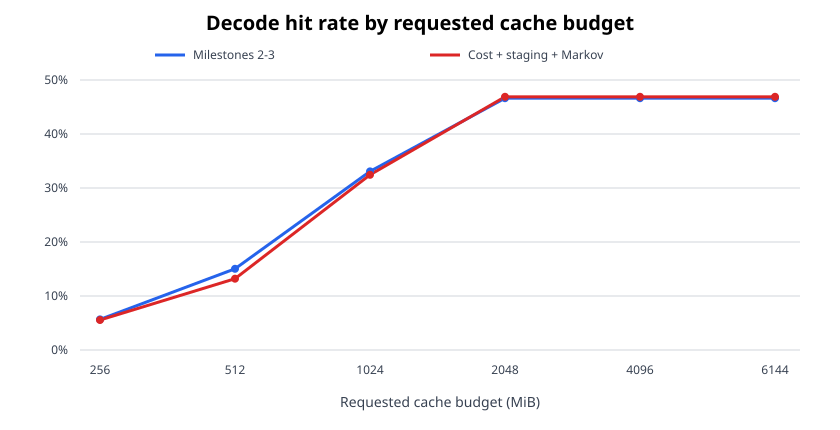
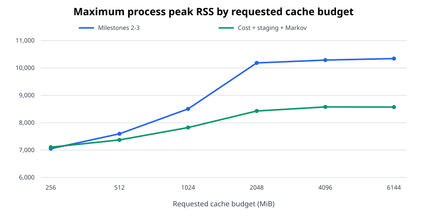

# MoE expert cache cost, staging, and prediction evaluation

## Scope

This iteration implements the remaining expert-cache priorities after prefill profiling and per-layer soft budgets:

1. Cost-aware admission with short and long frequency windows.
2. A bounded staging path with asynchronous Metal copies.
3. First-order Markov expert prediction and prefetch.

The cache remains opt-in through `--moe-cache-size`. The runtime memory limit still reduces unsafe requests. On the test machine, 4 GiB and 6 GiB requests both received a 2 GiB physical cache.

## Design

### Cost-aware multi-window admission

Each expert has two decaying frequency counters. The short counter decays every 256 accesses and the long counter decays every 4,096 accesses. The reuse benefit is:

```text
4 * short_frequency + long_frequency
```

When admission requires eviction, the candidate and first eviction victim are compared by reuse benefit per aligned byte. The candidate must exceed the victim score by 25 percent. Existing SLRU order and per-layer soft-budget victim selection remain unchanged.

Policy admission and physical slot allocation continue to use separate counters. Prefetch does not increment demand access, hit, or miss statistics.

### Staging and asynchronous Metal copies

The expert cache is now a private Metal buffer. CPU-visible model weights move through two 32 MiB shared staging buffers. Large experts are split into bounded chunks. Each staging buffer can have one in-flight blit command buffer; the CPU waits only when it reuses that staging buffer.

Copy commands and decode commands use the same Metal command queue. Cache updates submit copies before the next decode graph is submitted, so queue order provides visibility without a per-token CPU wait. Prefill preload still waits once before decode begins.

The fixed staging overhead is 64 MiB. Process RSS does not necessarily include all private Metal allocation, so RSS and the requested Metal cache capacity are reported separately.

### Markov prediction and prefetch

Each expert tensor keeps a first-order transition table from the experts selected at token `t` to the experts selected at token `t + 1`. Counts are periodically halved to bound history. At each update:

- Keep at most eight predictions per tensor.
- Require at least three observations and an estimated probability of at least 8 percent.
- Rank candidates by estimated probability per expert byte.
- Limit new prefetch data to `min(8 MiB, cache_capacity / 64)` per update.
- Pass predicted benefit through the same cost-aware admission path.

The cache reports prediction count, prefetch attempts, admissions, useful prefetches, and prefetched entries evicted before use.

## Validation

### Unit and build tests

- `test-moe-cache`: passed, including cost rejection, both frequency windows, fragmentation recovery, per-layer eviction, Markov prediction, and prefetch statistic isolation.
- `test-moe-profile`: passed on Metal outside the filesystem sandbox.
- `llama-cli` Metal build: passed.
- `git diff --check`: passed.

### Model and workload

- Model: `Qwen3.6-35B-A3B-UD-Q4_K_M.gguf`
- Device: Apple M5, Metal backend
- Inputs: 10 cases from 2,039 to 8,208 prompt tokens
- Output: 64 tokens per case
- `ubatch`: 512
- Requested budgets: 256, 512, 1,024, 2,048, 4,096, and 6,144 MiB
- Runs: 60 of 60 successful
- Physical allocation failures: 0
- Observed cost rejections: 0

| Requested MiB | Actual MiB | Mean hit rate | Max peak RSS MiB | Mean peak RSS MiB | Mean decode tok/s | Mean prefetch admissions | Mean useful | Mean wasted |
| ---: | ---: | ---: | ---: | ---: | ---: | ---: | ---: | ---: |
| 256 | 256 | 5.55% | 7,106.3 | 6,947.5 | 20.08 | 401.0 | 51.2 | 343.3 |
| 512 | 512 | 13.21% | 7,369.9 | 7,156.5 | 20.10 | 557.9 | 86.4 | 465.0 |
| 1,024 | 1,024 | 32.44% | 7,821.9 | 7,527.6 | 21.55 | 302.9 | 88.5 | 211.8 |
| 2,048 | 2,048 | 46.88% | 8,427.2 | 8,106.4 | 21.34 | 224.3 | 111.3 | 111.8 |
| 4,096 | 2,048 | 46.88% | 8,576.1 | 8,048.7 | 21.13 | 224.3 | 111.3 | 111.8 |
| 6,144 | 2,048 | 46.88% | 8,569.6 | 8,119.2 | 21.36 | 224.3 | 111.3 | 111.8 |





## Comparison with milestones 2 and 3

The comparison uses the same model, ten inputs, output length, and requested budgets. Positive RSS changes mean higher process RSS.

| Requested MiB | Hit-rate change | Max peak RSS change MiB | Decode tok/s change |
| ---: | ---: | ---: | ---: |
| 256 | -0.11 pp | +56.1 | -2.31 |
| 512 | -1.83 pp | -224.5 | -1.58 |
| 1,024 | -0.64 pp | -682.3 | -1.75 |
| 2,048 | +0.25 pp | -1,757.1 | -0.56 |
| 4,096 | +0.25 pp | -1,711.7 | -1.14 |
| 6,144 | +0.25 pp | -1,773.3 | -1.46 |

The 64-token workload is too short to amortize predictor warm-up at small budgets. At 256 MiB and 512 MiB, predicted experts often displace experts selected by the prefill profile. At the effective 2 GiB limit, demand hit rate improves by 0.25 percentage points and about half of prediction-prefetched entries are used before eviction.

The private destination and bounded staging path reduce measured process RSS from 512 MiB upward. The 256 MiB case instead shows the expected fixed staging overhead. This RSS reduction must not be interpreted as removing the private Metal cache allocation.

Short-output throughput regresses by 0.56 to 2.31 token/s. The extra transition updates, command-buffer submissions, and low-value prefetch traffic exceed the benefit from avoided demand copies in these runs.

## Longer decode diagnostic

One 2,039-token input was also run for 512 output tokens at three budgets. This is a diagnostic subset, not the full 60-run matrix.

| Actual MiB | Hit rate | Peak RSS MiB | Decode tok/s | Prefetch admissions | Useful prefetch ratio |
| ---: | ---: | ---: | ---: | ---: | ---: |
| 256 | 3.51% | 12,557.9 | 21.19 | 1,732 | 9.76% |
| 1,024 | 37.56% | 12,621.2 | 24.42 | 735 | 47.62% |
| 2,048 | 54.77% | 12,906.1 | 25.17 | 377 | 55.97% |

The longer run shows the intended steady-state trend: hit rate reaches 54.77 percent at 2 GiB and prefetch usefulness reaches 55.97 percent. The predictor is therefore useful when the budget can retain predictions and decode is long enough to reuse them.

## Conclusion

All three remaining mechanisms are implemented and physically safe in the tested 256 MiB to 6 GiB request range. Allocation failures remain zero. The staging path substantially lowers process peak RSS at effective budgets of 512 MiB and above, while Markov prefetch helps most at 2 GiB and during longer decode.

The current predictor should remain experimental. Before enabling it by default, the next optimization should add adaptive throttling based on recent useful-prefetch ratio and batch predictions across multiple tokens. This should suppress low-value traffic at 256 MiB and 512 MiB and recover the short-output throughput regression.
