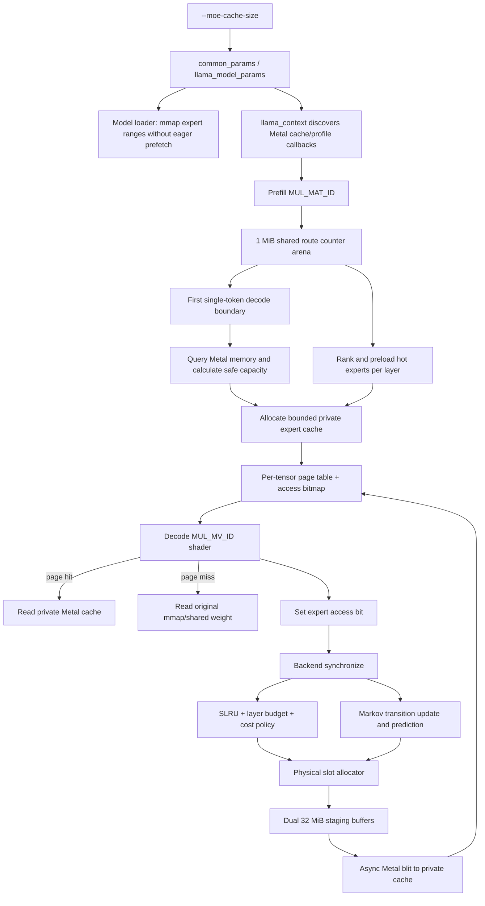

# llama.cpp macOS Metal MoE 专家缓存完整实验报告

## 1. 摘要

本实验面向一个明确问题：在统一内存有限的 macOS 设备上，如何用受控的专家权重缓存运行更大的 MoE 模型，并在不触发 Metal OOM 的前提下提高 decode 阶段的专家命中率。

最终实现从一个有容量上限的 P0 缓存开始，依次加入了以下能力：

1. prefill 路由统计；
2. per-layer 软预算；
3. decode 前热专家预装；
4. 成本感知和短期/长期双时间窗口准入；
5. 私有 Metal 缓存、双 staging buffer 和异步 blit；
6. 一阶 Markov 专家预测预取。

在 Apple M5、32 GB 统一内存和 `Qwen3.6-35B-A3B-UD-Q4_K_M.gguf` 上，最终版本完成了 10 条输入乘 6 档预算的 60/60 次运行，物理缓存分配失败为 0。64-token 短输出矩阵中，实际 2 GiB 缓存的平均命中率为 46.88%；单条 512-token 稳态诊断中，2 GiB 缓存命中率达到 54.77%，预测预取有效率达到 55.97%。

实验同时说明，命中率不是唯一目标。最终 Markov 版本在短输出上的吞吐下降了 0.56 至 2.31 token/s；小预算下预测污染明显。因此当前预测器应保持实验性质，下一步重点应是自适应预取节流、按层动态预算、逻辑专家级协同缓存和更精确的 A/B 消融。

## 2. 背景、目标和边界

### 2.1 初始问题

讨论从 llama.cpp 是否能在 iPhone 运行开始。结论是：llama.cpp 可以面向 Apple 平台构建并使用 Metal GPU 后端，但当前实验没有接入 Apple Neural Engine，也没有实现 iPhone 版本。考虑到 iPhone 的 jetsam、可用内存波动、应用生命周期和 Metal working set 限制比 macOS 更严格，工程顺序确定为：

```text
macOS 原型 -> 真实大模型调试 -> 策略和指标稳定 -> iPhone 迁移
```

Metal 对 decode 性能有直接影响，因为单 token decode 主要走矩阵向量计算。本项目的专家缓存只接入 Metal 的 MoE `MUL_MV_ID` 路径；prefill 的矩阵矩阵路径用于统计路由，不从缓存读取权重。

### 2.2 实验目标

- 为专家权重设置明确的物理内存上限。
- 缓存未命中时仍能从原始 GGUF mmap 权重执行，不要求全模型常驻缓存。
- 通过频率、LRU、prefill 统计和预测提升 decode 命中率。
- 控制 Metal 分配风险，较大的用户请求预算只能作为上限，不能强制分配。
- 记录命中、准入、物理分配、淘汰、预测、预取和峰值 RSS。
- 先在 macOS Metal 上完成，再考虑 iPhone。

### 2.3 当前实现边界

- 上游默认基线没有本报告中的 per-expert Metal 缓存和预测预取；这些功能都位于实验分支。
- 仅支持 Metal 后端，命令行帮助明确标记为 experimental。
- 缓存只在 `ne21 == 1` 的单 token `MUL_MV_ID` 路径启用。
- 不支持 mlock；启用缓存时专家 mmap 页面必须可以被系统回收。
- 不是完整的 out-of-core 引擎。未命中仍依赖原始 mmap 权重，缓存只是热专家副本。
- 没有 ANE 后端，也没有 iOS 应用封装。
- Markov 预测当前没有独立运行时开关，消融主要依赖不同里程碑提交。

## 3. 代码和实验时间线

| 阶段 | Git 提交 | 主要内容 |
| --- | --- | --- |
| 默认基线 | `4cf5cab65` | 同步上游 ggml，尚无专家缓存 |
| P0 | `51ae99fe8` | 有界专家缓存、mmap 专家预取控制、Metal 页表访问、动态安全容量 |
| 里程碑 1 | `618e17176` | prefill 路由统计和单一共享 counter arena |
| 里程碑 2-3 | `c0bdb4229` | 物理准入统计、碎片恢复、per-layer 软预算、prefill 热专家预装 |
| 里程碑 4-6 | `b6641d4ae` | 成本感知双时间窗口、staging 异步复制、Markov 预测预取和最终报告 |

最终代码位于个人仓库 `litao1991/llama.cpp-moe-cache` 的 `codex/moe-expert-cache` 分支。实验未创建上游 PR。

## 4. 实验环境和工作负载

### 4.1 硬件和模型

- 设备：Apple M5，32 GB 统一内存。
- 后端：Metal，全层 GPU offload。
- 模型：`/Users/litao/Documents/工具/Qwen3.6-35B-A3B-GGUF/Qwen3.6-35B-A3B-UD-Q4_K_M.gguf`。
- 模型大小：约 20.60 GiB。
- MoE 结构：40 个 MoE layer，每层 256 个专家，每 token 路由 8 个专家。
- 专家矩阵：每层 gate/up/down 3 组专家 tensor，共 120 个专家 tensor。

最初提供的是 NVFP4 目录路径，最终定量实验统一使用了可直接由 llama.cpp 加载的单个 GGUF Q4_K_M 文件，避免把模型格式差异混入缓存策略比较。

### 4.2 测试用例集

用例生成器位于 `/Users/litao/Documents/工具/moe-cache-eval/generate_cases.py`。它为 10 个不同领域生成合成长文本，并调用 llama.cpp tokenizer 通过二分搜索逼近目标长度。

| 用例 | 领域 | 实际输入 token | 短输出 token |
| --- | --- | ---: | ---: |
| case-01 | 中文分布式系统事故分析 | 2,039 | 64 |
| case-02 | English compiler optimization review | 2,542 | 64 |
| case-03 | 多语言事实检索 | 3,072 | 64 |
| case-04 | 代码审计与并发推理 | 3,583 | 64 |
| case-05 | 合同条款一致性审查 | 4,108 | 64 |
| case-06 | 合成临床研究摘要 | 4,842 | 64 |
| case-07 | 财务流水异常检测 | 5,624 | 64 |
| case-08 | 多角色需求对话归纳 | 6,415 | 64 |
| case-09 | JSON 可观测性日志分析 | 7,166 | 64 |
| case-10 | 混合领域长文档检索 | 8,208 | 64 |

这组输入覆盖中文、英文、多语言、代码、合同、临床、财务、对话、JSON 日志和混合检索，目的是让路由分布不局限于一种文本模式。后续还对 case-01 增加了 256-token 和 512-token 输出，用于观察预测器冷启动后的稳态表现。

### 4.3 统一运行参数

```text
context           = 9216
batch             = 2048
ubatch            = 512
threads           = 4
flash attention   = on
GPU layers        = all
output            = 64, 额外诊断为 256/512
requested budgets = 256/512/1024/2048/4096/6144 MiB
temperature       = 0
seed              = 20260812
warmup            = disabled
EOS               = ignored
```

每个预算和输入组合都独立加载模型。60 个任务用固定种子随机打乱，避免输入长度和预算始终按同一顺序执行。

### 4.4 指标采集

`run_benchmark_p0.py` 每 100 ms 使用 `ps` 采样进程 RSS，并从 llama.cpp 日志解析以下字段：

- 请求预算、decode 前可用内存、安全 reserve、最终实际容量；
- preloaded entries 和 bytes；
- accesses、hits、misses 和 hit rate；
- admission attempts、physical admissions、cost rejections；
- allocation failures、evictions、resident entries 和 bytes；
- staging batches、async copies；
- predictions、prefetch attempts/admissions、useful/wasted prefetches；
- prompt/decode throughput 和 Metal 内存明细。

单轮日志上限为 64 MiB，超时为 600 秒，运行结果可断点续跑。

### 4.5 复现实验

单次运行可使用与 harness 等价的命令：

```bash
build/bin/llama-cli \
  -m /Users/litao/Documents/工具/Qwen3.6-35B-A3B-GGUF/Qwen3.6-35B-A3B-UD-Q4_K_M.gguf \
  -ngl all -c 9216 -b 2048 -ub 512 -t 4 -tb 4 \
  --flash-attn on --moe-cache-size 1024 -n 64 \
  -f /Users/litao/Documents/工具/moe-cache-eval/cases/01-incident_zh-2039t.txt \
  --no-warmup -no-cnv -st --simple-io --no-display-prompt \
  -fit off --ignore-eos --temp 0 --seed 20260812 -lv 4
```

完整矩阵由以下命令驱动：

```bash
python3 /Users/litao/Documents/工具/moe-cache-eval/run_benchmark_p0.py \
  --model /Users/litao/Documents/工具/Qwen3.6-35B-A3B-GGUF/Qwen3.6-35B-A3B-UD-Q4_K_M.gguf \
  --binary build/bin/llama-cli \
  --cases /Users/litao/Documents/工具/moe-cache-eval/cases \
  --output /Users/litao/Documents/工具/moe-cache-eval/results-p1p2-final
```

脚本识别已经成功且包含关键指标的 `(case_id, budget)`，重新执行时会跳过这些组合。

## 5. 端到端代码架构

### 5.1 总体数据流



### 5.2 代码索引

| 层次 | 主要文件或函数 | 职责 |
| --- | --- | --- |
| 用户参数 | `common/arg.cpp`、`common_params::moe_cache_bytes` | 解析 `--moe-cache-size` 并传递上限 |
| 模型映射 | `llama_model_loader::init_mappings()` | 识别专家区间，避免启动阶段主动预取全部专家页 |
| 生命周期 | `llama_context::moe_cache_init()`、decode batch 边界 | 延迟分配、查询安全容量、分配失败退避 |
| prefill 统计 | `ggml_metal_moe_profile_*` | 管理单一 counter arena、reset、freeze 和统计读取 |
| 通用策略 | `ggml_moe_cache_policy` | 双时间窗口、SLRU、分层 victim、成本准入 |
| 物理空间 | `ggml_moe_cache_slots` | 对齐、first-fit、free-range 合并、碎片恢复 |
| 预测器 | `ggml_moe_markov` | 更新专家转移计数并返回 top prediction |
| Metal runtime | `ggml_metal_moe_cache` | tensor 注册、page table、access bitmap、preload、update 和统计 |
| 复制路径 | `copy_expert()`、`commit_copy()`、`wait_for_copy()` | shared staging 到 private cache 的分块异步 blit |
| kernel 绑定 | `ggml-metal-ops.cpp` | 仅在单 token `MUL_MV_ID` 绑定缓存/profile buffer |
| shader | `kernel_mul_mv_id` | 根据 page table 选择缓存或原权重，并记录访问 |
| 测试 | `tests/test-moe-cache.cpp`、`tests/test-moe-profile.cpp` | 策略、分配器、预测器和 Metal profile 正确性 |

### 5.3 参数层

主要文件：

- [`common/arg.cpp`](../../common/arg.cpp)
- [`common/common.h`](../../common/common.h)
- [`common/common.cpp`](../../common/common.cpp)
- [`include/llama.h`](../../include/llama.h)

`--moe-cache-size N` 将 MiB 转换为 `moe_cache_bytes`，默认 0 表示关闭。参数从 `common_params` 进入 `llama_model_params`。这样缓存是 opt-in，不改变默认 llama.cpp 行为。

### 5.4 模型加载和 mmap 层

主要文件：

- [`src/llama-model.cpp`](../../src/llama-model.cpp)
- [`src/llama-model-loader.cpp`](../../src/llama-model-loader.cpp)
- [`src/llama-mmap.cpp`](../../src/llama-mmap.cpp)

启用缓存后，`llama_model::load_tensors()` 调用：

```cpp
ml.init_mappings(true, use_mlock ? &pimpl->mlock_mmaps : nullptr, params.moe_cache_bytes == 0);
```

第三个参数使专家权重不再被启动阶段整体 `WILLNEED`。`llama_model_loader_is_moe_expert()` 识别 gate/up/down 等专家 tensor 名称，合并其文件区间，对非专家区间执行预取，对专家区间使用 random access 建议。

这一层是运行大 MoE 模型的关键之一：只做 Metal 缓存而继续在模型加载时主动 fault-in 全部专家页面，会削弱有界缓存的意义。代码还禁止 `mlock + MoE cache`，因为 mlock 会阻止专家 mmap 页被系统回收。

### 5.5 上下文生命周期和动态容量

主要文件：

- [`src/llama-context.cpp`](../../src/llama-context.cpp)
- [`src/llama-context.h`](../../src/llama-context.h)

context 初始化时通过 backend registry 查找：

```text
ggml_backend_metal_set_moe_cache
ggml_backend_metal_set_moe_profile
ggml_backend_metal_reset_moe_profile
```

缓存不会在模型加载后立即分配。系统先启用 prefill profile，并把 `moe_cache_pending` 设为 true。多 token batch 继续收集 profile；遇到第一个单 token batch 时才执行 `llama_context::moe_cache_init()`。

容量计算公式为：

```text
alignment = 256 MiB
reserve   = max(1 GiB, total_device_memory / 16)
safe      = floor((free_memory - reserve) / alignment) * alignment
capacity  = min(user_requested, safe)
```

若 Metal 分配失败，容量按一半递减并重新对齐，直到成功或低于 256 MiB。该策略将命令行值定义成上限，而不是强制分配量。

P0 测试时，高预算请求被裁剪为 1,536 MiB；后续里程碑由于 decode 边界的可用内存状态不同，被裁剪为 2,048 MiB。这也是 2/4/6 GiB 请求出现同一命中率平台的直接原因：它们拿到的是同一个实际容量。

### 5.6 prefill 路由统计层

主要文件：

- [`ggml/src/ggml-metal/ggml-metal-moe-profile.cpp`](../../ggml/src/ggml-metal/ggml-metal-moe-profile.cpp)
- [`ggml/src/ggml-metal/ggml-metal-moe-profile.h`](../../ggml/src/ggml-metal/ggml-metal-moe-profile.h)
- [`ggml/src/ggml-metal/ggml-metal-ops.cpp`](../../ggml/src/ggml-metal/ggml-metal-ops.cpp)
- [`ggml/src/ggml-metal/ggml-metal.metal`](../../ggml/src/ggml-metal/ggml-metal.metal)

profile 使用一个 1 MiB shared Metal buffer 作为 counter arena。每个专家 tensor 分配 `n_experts` 个 `uint32_t` 计数器切片。Qwen 模型需要：

```text
120 tensors * 256 experts * 4 bytes = 120 KiB
```

矩阵矩阵 prefill 路径在 ID map kernel 中把 token-per-expert 计数累加到 arena；矩阵向量路径每次路由加 1。position 0 的新 prefill 会重置旧数据，后续 prefill chunk 保留累计值。进入 decode 前调用 `finish()` 冻结并打印统计。

### 5.7 通用缓存策略和物理槽位层

主要文件：

- [`ggml/src/ggml-moe-cache.h`](../../ggml/src/ggml-moe-cache.h)
- [`ggml/src/ggml-moe-cache.cpp`](../../ggml/src/ggml-moe-cache.cpp)

这一层与 Metal API 解耦，分为两个类：

1. `ggml_moe_cache_policy`：决定命中、准入和淘汰谁；
2. `ggml_moe_cache_slots`：负责 4 KiB 对齐、offset、空闲区间和物理分配。

策略使用 SLRU：新条目进入 probation，第二次命中后提升到 protected；protected 默认目标为缓存容量的 80%。淘汰优先从 probation 的尾部开始，必要时将 protected LRU 降级。

缓存 key 为：

```text
key = (tensor_id << 32) | expert_id
```

因此 gate/up/down 是三个独立缓存对象。它们共享同一个路由决策，但当前会分别占用空间、统计命中和复制权重。

槽位层用按 offset 排序的 `free_ranges` 做 first-fit 分配，并在释放时合并相邻区间。策略准入和物理准入分别计数，避免把“决定缓存”误报成“已经得到物理 offset”。

### 5.8 Metal 缓存和 shader 路径

主要文件：

- [`ggml/src/ggml-metal/ggml-metal-moe-cache.mm`](../../ggml/src/ggml-metal/ggml-metal-moe-cache.mm)
- [`ggml/src/ggml-metal/ggml-metal-moe-cache.h`](../../ggml/src/ggml-metal/ggml-metal-moe-cache.h)
- [`ggml/src/ggml-metal/ggml-metal-ops.cpp`](../../ggml/src/ggml-metal/ggml-metal-ops.cpp)
- [`ggml/src/ggml-metal/ggml-metal.metal`](../../ggml/src/ggml-metal/ggml-metal.metal)

每个专家 tensor 对应一个 `ggml_metal_moe_tensor_cache`，保存原 tensor、tensor id、layer、expert size、page table、access flags 和 Markov 状态。

page table 是每专家一个 `uint64_t offset`。`UINT64_MAX` 表示未缓存。decode shader 的核心逻辑是：

```cpp
src0_cur = original_expert_weight;
if (cache_enabled) {
    offset = page_table[expert];
    if (offset != UINT64_MAX) {
        src0_cur = private_cache + offset;
    }
    access[expert] = 1;
}
```

所以 miss 不会使推理失败，而是直接读取原始 shared/mmap 权重。access bit 对 hit 和 miss 都会记录，backend synchronize 后由 CPU 扫描并更新缓存。

## 6. 各技术优化点和实际代码细节

### 6.1 P0：有界缓存和安全容量

### 方案

- 新增 `--moe-cache-size`。
- 延迟到 decode 前查询设备内存并分配。
- 保留至少 1 GiB 或总内存 1/16 的安全余量。
- 以 256 MiB 对齐实际容量。
- 失败时容量减半重试。
- 避免启动时预取全部专家 mmap 页面。
- shader 在 page-table miss 时回退到原权重。
- 用频率阈值 2 和 SLRU 管理有界缓存。

### 效果

P0 前，4 GiB 和 6 GiB 强制请求在同一测试集上都是 0/10 成功。P0 后所有 60 个组合成功，没有 Metal OOM。高请求预算被安全裁剪为 1,536 MiB。

| 请求 MiB | 实际 MiB | 平均命中率 | 平均峰值 RSS MiB | decode tok/s | 成功 |
| ---: | ---: | ---: | ---: | ---: | ---: |
| 256 | 256 | 4.16% | 3,453 | 22.61 | 10/10 |
| 512 | 512 | 7.63% | 3,957 | 27.80 | 10/10 |
| 1,024 | 1,024 | 19.33% | 4,956 | 24.50 | 10/10 |
| 2,048 | 1,536 | 31.35% | 6,004 | 25.10 | 10/10 |
| 4,096 | 1,536 | 31.35% | 5,991 | 26.59 | 10/10 |
| 6,144 | 1,536 | 31.35% | 6,004 | 23.94 | 10/10 |

P0 首先解决的是“可运行性”，而不是最高命中率。大预算平台说明动态安全上限工作正常。

### 6.2 里程碑 1：prefill 路由采集

### 方案

在 prefill 期间只统计，不分配专家缓存。到第一个 decode token 前冻结 profile。这样可以利用长输入提供的路由先验，又不会在 prefill 大矩阵计算时引入缓存复制和页表查询。

真实模型验证得到：

| 指标 | 结果 |
| --- | ---: |
| profile expert tensors | 120 |
| 总 counter | 30,720 |
| 实际 arena 使用 | 120 KiB |
| prefill token | 2,048 |
| 每 tensor selections | 16,384 |
| 总 selections | 1,966,080 |
| 每层活跃专家均值 | 221.85 / 256 |
| 活跃范围 | 205 至 252 |

总计数严格符合：

```text
2048 token * 40 layer * 8 experts * 3 tensors = 1,966,080
```

gate/up/down 三个 tensor 的路由分布一致，证明 counter 采集与共享 router ID 对齐。

### 效果和解释

里程碑 1 还没有使用 profile 预装，所以 256 MiB 下长 decode 命中率仍很低：

| 输出 token | accesses | hits | hit rate | decode tok/s |
| ---: | ---: | ---: | ---: | ---: |
| 256 | 244,800 | 5,023 | 2.05% | 20.80 |
| 512 | 490,560 | 8,460 | 1.72% | 20.61 |

第一个输出 token 使用 prefill logits，因此真正单 token decode 次数是 `N - 1`：

```text
(256 - 1) * 40 * 8 * 3 = 244,800
(512 - 1) * 40 * 8 * 3 = 490,560
```

低命中不是 profile 采集错误，而是当时 profile 尚未进入准入和 preload 路径。

### 6.3 里程碑 2：per-layer 软预算和物理分配修复

### 物理准入统计

早期日志只记录策略认为某专家应当准入，但不能证明它真正获得了连续物理空间。里程碑 2 将统计分成：

- `admission_attempts`：策略尝试；
- `admissions`：物理 offset 分配成功；
- `allocation_failures`：没有得到物理槽；
- `resident_entries/resident_bytes`：最终物理状态。

### 碎片恢复

`ggml_moe_cache_slots::finalize()` 先释放策略淘汰项，再 first-fit 分配。如果总空闲空间足够但最大连续区间不足，它会：

1. 暂时从 policy 移除新 candidate；
2. 继续淘汰和合并 free range；
3. 得到足够连续空间后恢复 candidate；
4. 再建立 `key -> offset`。

暂时移除 candidate 很重要，否则尚未获得 slot 的新条目可能被 policy 自己选成 victim，造成策略状态和物理状态不一致。

### per-layer 软预算

tensor 名称中的 `blk.N.*` 被解析为 layer N。每层目标为：

```text
layer_target = global_capacity / n_layers
```

它不是硬分区。空闲空间仍可被任何 layer 使用；只有需要淘汰时，优先选择超出软目标最多的 layer，再在该 layer 内使用 SLRU。这样避免少数层的活跃路由抢占全部缓存。

### 6.4 里程碑 3：decode 前热专家预装

### 方案

prefill 结束后，候选按下式排序：

```text
score = prefill_selection_count / aligned_expert_bytes
```

预装分两轮：

1. 首先遵守 per-layer target，保证各 layer 有基本覆盖；
2. 再按全局 score 使用剩余空间。

复制完成后更新 page table，并重置 runtime cache stats，使 decode 命中率不混入 preload 的两次访问和准入操作。

### 效果

| 请求 MiB | 实际 MiB | P0 hit | M2-3 hit | 提升 | 平均 preload MiB |
| ---: | ---: | ---: | ---: | ---: | ---: |
| 256 | 256 | 4.16% | 5.66% | +1.50 pp | 255.8 |
| 512 | 512 | 7.63% | 15.04% | +7.41 pp | 511.7 |
| 1,024 | 1,024 | 19.33% | 33.08% | +13.75 pp | 1,023.7 |
| 2,048 | 1,536 / 2,048 | 31.35% | 46.63% | 容量不同 | 2,047.2 |

512 MiB 的命中率接近翻倍；1,024 MiB 提升 13.75 个百分点。说明 prefill 路由与短 decode 路由有较强相关性。


### 6.5 里程碑 4：成本感知和双时间窗口准入

### 双时间窗口

`ggml_moe_cache_history` 保存：

```text
short_frequency: 每 256 次访问衰减一半
long_frequency:  每 4096 次访问衰减一半
benefit:         4 * short_frequency + long_frequency
```

短窗口快速适应局部路由变化，长窗口保留稳定热点。准入阈值仍要求短期或长期频率至少达到 2。

### 成本感知比较

缓存有足够空闲空间时直接允许准入；需要淘汰时，将 candidate 与 policy 选出的第一个 victim 比较：

```text
candidate_benefit / candidate_bytes
    > 1.25 * victim_benefit / victim_bytes
```

代码用交叉乘法表达为：

```cpp
candidate_benefit * victim_bytes * 4
    > victim_benefit * candidate_bytes * 5
```

预测预取通过 `prefetch()` 使用同一成本通道，但不增加 demand access/hit/miss，防止预取把自身伪装成命中。

### 实际结果

最终 60 轮中 `cost_rejections = 0`。单元测试确认拒绝逻辑有效，这一结果不是统计漏记，而是当前 workload 下第一淘汰候选通常是历史收益为 0 的冷条目，因此新 candidate 可以通过。

这说明当前成本模型的运行时影响有限。它只比较第一个 victim，没有估计为了容纳大 candidate 可能需要淘汰的整个集合，也没有把 copy cost、预测有效率和剩余 decode 长度纳入收益。

### 6.6 里程碑 5：staging 和异步 Metal 复制

### 从 shared 目标改为 private 目标

M2-3 直接把 expert weight memcpy 到 shared Metal cache。最终实现把目标 cache 改成 private Metal buffer：

```cpp
buffer = ggml_metal_buffer_init(dev, capacity_bytes, false);
```

CPU 无法直接写 private buffer，因此增加两个 32 MiB shared staging buffer。`copy_expert()` 将大 expert 分块：

```text
CPU mmap weight -> shared staging -> MTLBlitCommandEncoder -> private cache
```

### 双缓冲和同步语义

每个 staging arena 允许一个 in-flight command buffer。只有再次复用该 arena 时才 `waitUntilCompleted`。普通 cache update 在结尾调用 `commit_copy()`，不等待复制完成。

安全性依赖同一个 Metal command queue 的提交顺序：

```text
本轮 decode 完成 -> 提交 cache blit -> 下一轮 decode graph 提交
```

因此下一轮 shader 读取已更新 page table 时，之前的 blit 已按队列顺序执行。prefill preload 是例外：第一轮 decode 前必须调用 `wait_for_copy()` 确保预装完成。

### 效果和代价

- 固定 staging 开销为 64 MiB。
- 从 512 MiB 实际 cache 开始，进程峰值 RSS 明显下降。
- 2 GiB 下最大峰值 RSS 从 10,184.3 MiB 降到 8,427.2 MiB，下降约 1,757 MiB。
- 256 MiB 下峰值 RSS 增加约 56 MiB，与固定 staging 开销一致。

必须注意：private Metal allocation 不一定完全计入进程 RSS。RSS 下降不等于统一内存总消耗减少，也不能将 RSS 和 Metal 报告值直接相加。

### 6.7 里程碑 6：Markov 专家预测预取

### 状态模型

每个专家 tensor 保存一个 256 x 256 的 `uint16_t` transition matrix 和每个源状态的 total。对 token t 的 8 个 active experts 和 token t+1 的 8 个 active experts，更新所有有效转移。total 超过 32,768 时将该行计数减半，限制历史陈旧和溢出。

`observe()` 返回概率最高的最多 8 个专家。Metal cache update 的筛选条件为：

```text
transition count >= 3
estimated probability >= 8%
candidate is not resident
```

全局候选按下式排序：

```text
estimated_probability / expert_bytes
```

每个 update 的新增预取上限为：

```text
min(8 MiB, cache_capacity / 64)
```

传给成本策略的 predicted benefit 为：

```text
count * 1000 / total
```

`prefetched` 集合用于区分：

- useful prefetch：之后真实 demand hit；
- wasted prefetch：使用前被淘汰。

### 预测器调参过程

预测器不是一次得到最终参数，而是经历了多轮失败和收敛：

| 版本 | 256 MiB / 256 output 关键结果 | 主要问题 |
| --- | --- | --- |
| 初始 staging/Markov | predictions 和 prefetch 为 0 | 统计只覆盖非 resident candidate，无法观察预测是否产生 |
| fallback 预测 | hit 7.79%，14.28 tok/s；161,098 prefetch，718 useful，160,332 wasted | 预取风暴，命中上升但吞吐严重下降 |
| count >= 3 + 字节上限 | hit 3.60%，19.69 tok/s；1,533 prefetch，71 useful | 流量降低，但小预算污染仍严重 |
| 再加 8% 概率阈值 | hit 3.35%，21.19 tok/s；1,332 prefetch，126 useful | 吞吐恢复，仍有较多 wasted |
| 同参数 1,024 MiB | hit 36.89%，23.68 tok/s；496 prefetch，205 useful | 更大容量下预测质量明显改善 |

这段过程揭示了一个核心规律：预测数量本身没有价值，只有在 candidate 能活到被真实访问，并且节省的 demand copy 大于预测维护和 blit 成本时，预取才有效。

## 7. 完整效果对比

### 7.1 三阶段命中率

| 请求 MiB | P0 实际 / hit | M2-3 实际 / hit | M4-6 实际 / hit |
| ---: | ---: | ---: | ---: |
| 256 | 256 / 4.16% | 256 / 5.66% | 256 / 5.55% |
| 512 | 512 / 7.63% | 512 / 15.04% | 512 / 13.21% |
| 1,024 | 1,024 / 19.33% | 1,024 / 33.08% | 1,024 / 32.44% |
| 2,048 | 1,536 / 31.35% | 2,048 / 46.63% | 2,048 / 46.88% |
| 4,096 | 1,536 / 31.35% | 2,048 / 46.63% | 2,048 / 46.88% |
| 6,144 | 1,536 / 31.35% | 2,048 / 46.63% | 2,048 / 46.88% |

M2-3 是短输出命中率提升最大的阶段，主要贡献来自 prefill preload 和 per-layer 覆盖。M4-6 在 256 MiB、512 MiB 和 1,024 MiB 下略低于 M2-3，说明 Markov 预取在小预算和短输出下会挤出更有价值的 prefill hot experts。

### 7.2 M2-3 与 M4-6 的直接对比

| 请求 MiB | hit 变化 | 最大峰值 RSS 变化 MiB | decode tok/s 变化 |
| ---: | ---: | ---: | ---: |
| 256 | -0.11 pp | +56.1 | -2.31 |
| 512 | -1.83 pp | -224.5 | -1.58 |
| 1,024 | -0.64 pp | -682.3 | -1.75 |
| 2,048 | +0.25 pp | -1,757.1 | -0.56 |
| 4,096 | +0.25 pp | -1,711.7 | -1.14 |
| 6,144 | +0.25 pp | -1,773.3 | -1.46 |


### 7.3 最终 60 轮矩阵

| 请求 MiB | 实际 MiB | 平均 hit | 最大峰值 RSS MiB | decode tok/s | 平均 prefetch | useful ratio | allocation failures |
| ---: | ---: | ---: | ---: | ---: | ---: | ---: | ---: |
| 256 | 256 | 5.55% | 7,106.3 | 20.08 | 401.0 | 12.77% | 0 |
| 512 | 512 | 13.21% | 7,369.9 | 20.10 | 557.9 | 15.49% | 0 |
| 1,024 | 1,024 | 32.44% | 7,821.9 | 21.55 | 302.9 | 29.22% | 0 |
| 2,048 | 2,048 | 46.88% | 8,427.2 | 21.34 | 224.3 | 49.62% | 0 |
| 4,096 | 2,048 | 46.88% | 8,576.1 | 21.13 | 224.3 | 49.62% | 0 |
| 6,144 | 2,048 | 46.88% | 8,569.6 | 21.36 | 224.3 | 49.62% | 0 |

小预算下 prefetch admissions 更多、有效率更低；2 GiB 下预取数量更少而有效率接近 50%。这说明容量决定了预测项是否有足够生存时间。

### 7.4 512-token 稳态诊断

| 实际 MiB | hit rate | peak RSS MiB | decode tok/s | prefetch admissions | useful ratio |
| ---: | ---: | ---: | ---: | ---: | ---: |
| 256 | 3.51% | 12,557.9 | 21.19 | 1,732 | 9.76% |
| 1,024 | 37.56% | 12,621.2 | 24.42 | 735 | 47.62% |
| 2,048 | 54.77% | 12,906.1 | 25.17 | 377 | 55.97% |

长输出给预测器更多学习和复用时间。2 GiB 下 hit 和 useful ratio 都继续上升，证明 Markov 思路在足够容量和足够 decode 长度时有效；256 MiB 下仍然不适合积极预取。

## 8. 为什么命中率会停止上升

实验中多次出现“预算增加但 hit 不再提高”，原因不是单一算法失效，而是以下因素叠加：

1. **请求预算不等于实际预算。** 2/4/6 GiB 最终都被裁剪为 2 GiB，因此命中率完全相同是预期结果。
2. **prefill 工作集很宽。** 每层 256 个专家中平均有 221.85 个在 2,048-token prefill 中被使用，单纯缓存少量热点无法覆盖全部后续路由。
3. **一个逻辑专家对应三个独立 tensor。** gate/up/down 会分别占空间；缓存有效容量不是按逻辑专家数量计算。
4. **短输出冷启动。** 64-token 测试只有 63 次真实 decode step，Markov 可学习时间有限。
5. **小预算污染。** 预测项会挤出 prefill hot experts，尤其在 256 MiB 和 512 MiB 下。
6. **cache 只服务单 token MV 路径。** 它不改善 prefill，也没有覆盖 `ne21 > 1` 的 batched decode。
7. **命中率口径是 tensor access。** 每 token 每层的 8 个逻辑专家会在 3 个 tensor 上计数，不是按 token 去重的“逻辑专家命中率”。

## 9. 遇到的问题和解决过程

### 9.1 模型和仓库路径

- 初始模型路径是目录，最终切换到明确的 GGUF 文件。
- 初始 GitHub URL 不存在，后续确认个人仓库为 `https://github.com/litao1991/llama.cpp-moe-cache`。
- 所有开发都在 `codex/moe-expert-cache` 分支完成，按里程碑分别提交。

### 9.2 大预算 Metal OOM

早期把用户预算当成强制分配量，4/6 GiB 请求失败。P0 改成 decode 边界动态查询、保留安全余量和分配失败减半重试后，60/60 成功。

### 9.3 profile 小 buffer 多实例导致 OOM

第一版为每个专家 tensor 创建一个小 Metal counter buffer。合成测试通过，但完整模型创建了 120 个 Metal residency set，触发 OOM。改成一个 1 MiB arena 和一个 residency set 后问题消失。

### 9.4 profile 正确但命中率仍低

里程碑 1 只收集 profile，没有预装。256/512-token 输出命中率只有 2.05%/1.72%。后续用 profile 做 decode 前 preload 才产生显著提升。

### 9.5 策略准入与物理准入混淆

策略日志显示“已准入”，但连续区间可能不存在。通过分离 attempts/admissions/failures、增加 resident 指标并实现碎片恢复，最终矩阵 allocation failures 为 0。

### 9.6 Markov 预取风暴

宽松 fallback 产生 161,098 次预取，其中只有 718 次有效，吞吐降到 14.28 token/s。最终增加最少观察次数、8% 概率阈值和每 update 字节上限，把预取量降低两个数量级。

### 9.7 异步复制的正确性

不在每 token 等待 blit 能提高并行性，但 page table 已经由 CPU 更新。最终依赖同一 command queue 的提交顺序确保 blit 在下一轮 decode 前完成；preload 阶段则显式等待。单测、Metal profile 测试和真实模型均通过。

### 9.8 测试环境问题

- 沙箱内 Metal profile 测试无法分配 1 MiB buffer，移到沙箱外后通过。
- 非交互 shell 的 PATH 中没有 CMake，改用工作区 `.codex-deps` 内 CMake。
- 这些属于执行环境限制，不是缓存代码失败。

## 10. 正确性验证

### 10.1 单元测试

[`tests/test-moe-cache.cpp`](../../tests/test-moe-cache.cpp) 覆盖：

- frequency threshold admission；
- SLRU protected/probation 行为；
- 不同大小条目的淘汰；
- oversize 和 erase；
- 4 KiB 对齐与 free-range 合并；
- 碎片恢复和额外淘汰；
- per-layer over-budget victim；
- 成本感知拒绝；
- 短期/长期频率衰减；
- Markov 确定性预测；
- prefetch 不污染 demand access stats；
- resident prefetch 不被错误成本拒绝。

### 10.2 Metal profile 测试

`test-moe-profile` 验证 arena 分配、tensor slice、reset、total 和 finish。最终沙箱外测试通过。

### 10.3 Metal 数值测试

里程碑 1 对 `MUL_MAT_ID` 执行了 792/792 个数值对比用例，覆盖矩阵向量和矩阵矩阵 dispatch。

### 10.4 真实模型验证

- ubatch 128 smoke：通过。
- ubatch 512 smoke：通过。
- output 256：通过。
- output 512：通过。
- 60-run 预算矩阵：P0、M2-3、M4-6 均完成。
- 最终 physical allocation failures：0。

## 11. 指标解释和实验局限

1. RSS 是进程驻留页，Metal working set 是设备视角，两者口径不同，不能简单相加。
2. private Metal buffer 可能不完整反映在 RSS 中，因此最终 RSS 降低不是总内存等量降低。
3. 每个预算/用例只有一轮。命中率较稳定，但吞吐会受温度、文件缓存、pipeline cache 和后台负载影响。
4. P0 和后续里程碑的 prefill 页面驻留状态不同，P0 RSS 不应与 M2-3 直接作等口径结论。
5. M2-3 与 M4-6 使用相同 workload，二者的差值更有可比性。
6. 64-token 矩阵偏向短输出，不足以完全展示预测器稳态价值。
7. synthetic inputs 便于控制长度和复现，但不能代替真实会话、代码仓库问答和长文档 RAG 流量。
8. 当前 hit rate 按三个专家 tensor 分别计数，不能直接解释成逻辑专家或 token 的命中概率。

## 12. 尚未实现的潜在优化点

以下顺序综合预期收益、实现风险和当前测量暴露的问题。

### P0：自适应预测节流

维护最近窗口的：

```text
useful_prefetch_ratio
wasted_prefetch_ratio
prefetch_bytes / demand_bytes
cache pressure
```

当 useful ratio 低于阈值或预算小于某一水平时自动降低预测数、提高概率阈值，甚至关闭预取。当前 256 MiB useful ratio 只有 12.77%，最需要该机制。

### P0：逻辑专家级协同

Qwen 每个 layer 的 gate/up/down 使用相同 expert IDs。目前为 3 个 tensor 维护 3 份 Markov table，并独立预取。可以改为每 layer 只预测一次，再把三个权重作为 bundle 评估：

- Markov 状态内存和 CPU 更新可接近减少 3 倍；
- 避免只缓存同一逻辑专家的一部分 tensor；
- 成本分母改成三组权重总 bytes。

代价是 bundle 变大，可能加剧碎片和小预算准入困难，因此需要与自适应策略一起做。

### P0：动态 per-layer 预算

当前每层目标相等。可根据 prefill 热度、decode miss rate、active working set、专家大小和预测稳定性动态调整：

```text
layer_budget proportional to expected_saved_bytes_per_token
```

还可以设置最小保底和最大上限，避免热点层完全挤压其他层。

### P1：成本模型比较完整 eviction set

当前只比较第一个 victim。更准确的算法应先模拟为了获得连续空间需要淘汰的全部条目，再计算：

```text
candidate expected reuse benefit
    vs sum(victim lost benefit) + copy cost + fragmentation penalty
```

这也能让真实 workload 中长期为 0 的 `cost_rejections` 更有区分度。

### P1：GPU compact access queue

CPU 目前每 token 扫描 120 x 256 = 30,720 个 access flags。可以在 GPU 上写 compact expert ID queue 或位图压缩，只把实际访问项传回 CPU，降低 Markov 和 cache update 的固定成本。

### P1：复制合并和事件同步

- 合并同 layer 或相邻 destination offset 的 blit；
- 用 shared event/fence 明确 page table 可见性；
- 双缓冲扩展为按设备能力调整的 staging ring；
- 基于 copy backlog 动态限制 prefetch。

### P1：更强的预测器

- prefill prior 与短期 decode Markov 混合；
- 二阶或 n-gram transition；
- 利用 router logits/top-k margin，而不只用最终 expert ID；
- sparse transition table，减少 256 x 256 dense table；
- 跨请求保留模型级稳定先验，同时隔离不同 session。

### P1：支持 batched decode

当前只有 `ne21 == 1` 才绑定 cache。server 多 sequence 或 speculative/batched decode 可能绕过缓存。需要为 `MUL_MM_ID` 或小 batch ID kernel 增加 page-table 分组访问，并重新评估并发复制安全性。

### P2：更强的物理分配器

当前 first-fit + 合并 + 淘汰恢复已经消除了测试中的 failure，但仍可探索：

- size class；
- buddy allocator；
- layer-local arena；
- 可选 compaction 和 page table 批量重写。

### P2：真正的 out-of-core 专家后端

目前 miss 直接读 mmap 权重。若要运行明显超过统一内存的模型，需要更完整的数据生命周期：

- copy 后对冷 mmap 页执行 `DONTNEED`；
- 直接文件 I/O 或 MTLIO；
- SSD -> staging -> private Metal cache；
- 限制并发 page fault 和 I/O queue depth；
- 将 GGUF 专家区按可流式读取方式布局。

这是从“热副本缓存”走向“专家权重分页系统”的关键一步，复杂度和平台差异也最大。

### P2：系统化性能评估

- 每个点至少重复 3 至 5 次；
- 控制电源、温度和后台任务；
- 全量运行 64/256/512/1024 output；
- 分别测 cold file cache 和 warm file cache；
- 增加首 token latency、p50/p95 decode latency、能耗和 Metal peak allocation；
- 增加 feature flags，对 preload、cost、staging 和 Markov 做同一 commit 下的严格消融。

## 13. iPhone 迁移建议

macOS 版本稳定后，iPhone 版本应按以下顺序推进：

1. 先将当前 Metal cache 和 policy 编译进 iOS static library，保持算法不变。
2. 用 Swift/Objective-C 包装 `--moe-cache-size` 对应参数，而不是暴露命令行。
3. 将 64 MiB 固定 staging 改成设备相关配置；小内存 iPhone 可从 4 至 16 MiB ring 起步。
4. 监听 memory warning、前后台切换和 thermal state，动态缩小 cache 或停用预测预取。
5. 用 Metal `recommendedMaxWorkingSetSize` 和当前 allocated size 校准安全 reserve，不能照搬 macOS 32 GB 的 1 GiB floor。
6. 先验证单会话、短 context，再扩展长 context 和多会话。
7. iPhone 上优先启用 prefill preload 和 per-layer budget；Markov 只有在 useful ratio 达标后再打开。

Apple Neural Engine 仍不在本实验范围。llama.cpp 的现有计算图、量化 kernel 和动态 MoE 路由更自然地映射到 Metal GPU；ANE 需要独立的 Core ML 图转换、动态路由表达和权重分页方案，不能视为当前 Metal cache 的简单替换。

## 14. 最终结论

本实验完成了一个可运行、可测量、有安全容量边界的 macOS Metal MoE 专家缓存原型。最有效的优化是：

1. decode 前动态安全容量，首先消除高预算 OOM；
2. prefill profile + per-layer preload，显著提高短输出命中率；
3. 物理槽位与策略状态分离，消除碎片造成的假准入；
4. private cache + bounded async staging，降低了高预算下的进程峰值 RSS；
5. Markov 在 2 GiB 和较长 decode 下有效，但在小预算短输出下仍需要自适应节流。

最终版本证明，在实际缓存容量 2 GiB 时，可以让约 20.60 GiB 的 Qwen3.6-35B-A3B GGUF 模型稳定完成长输入和 decode 测试，并把短输出平均命中率提高到 46.88%、512-token 稳态命中率提高到 54.77%。但它仍是热专家副本缓存，而非完整的 out-of-core MoE runtime。

下一阶段不应继续无条件增加预测复杂度。更高优先级是减少无效预取、合并三个 tensor 的重复路由预测、动态分配 layer 预算，并建立可在同一二进制中严格开关各策略的性能消融体系。完成这些工作后，再进入 iPhone 内存压力和应用生命周期适配，会更稳妥。

## 15. 数据和关联报告

- P0 原始结果：`/Users/litao/Documents/工具/moe-cache-eval/results-p0/runs.csv`
- 里程碑 1 结果：`/Users/litao/Documents/工具/moe-cache-eval/results-m1-*`
- 里程碑 2-3 原始结果：`/Users/litao/Documents/工具/moe-cache-eval/results-m23-final/runs.csv`
- 里程碑 4-6 原始结果：`/Users/litao/Documents/工具/moe-cache-eval/results-p1p2-final/runs.csv`
- 512-token 诊断：`/Users/litao/Documents/工具/moe-cache-eval/results-p1p2-steady/runs.csv`
- 里程碑 1 报告：[`moe-cache-milestone-1.md`](moe-cache-milestone-1.md)
- 里程碑 2-3 报告：[`moe-cache-milestones-2-3.md`](moe-cache-milestones-2-3.md)
- 里程碑 4-6 报告：[`moe-cache-cost-staging-markov.md`](moe-cache-cost-staging-markov.md)
