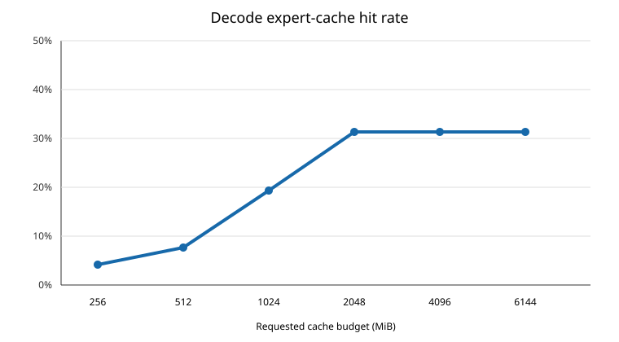
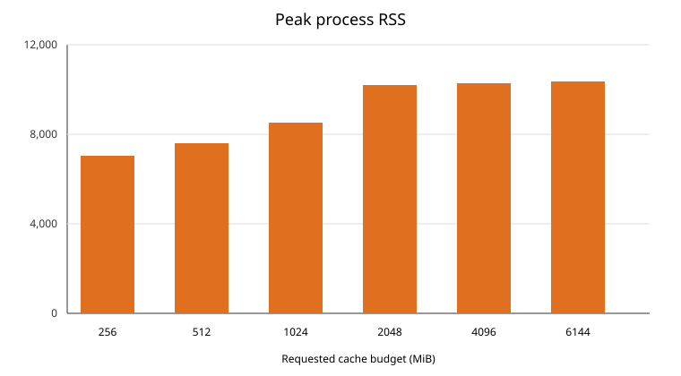

# MoE expert cache milestones 2 and 3

## Scope

Milestone 2 separates policy admission from physical allocation, reports the resident cache state, recovers from fragmented free space, and applies a per-layer soft budget during eviction. Milestone 3 preloads experts from the prefill routing profile before decode.

The cache remains opt-in through `--moe-cache-size`. The existing memory safety limit can reduce a requested budget. On the test machine, requests from 2 GiB through 6 GiB resulted in a 2 GiB cache.

## Design

### Physical admission

The slot allocator owns the physical statistics:

- `admission_attempts`: the policy selected an expert for admission.
- `admissions`: an expert received a physical slot.
- `allocation_failures`: no physical slot could be created.
- `resident_entries` and `resident_bytes`: final physical residency.

If total free space is sufficient but fragmented, the new candidate is temporarily removed from the policy. The allocator then evicts old resident entries until a contiguous range is available and restores the candidate. This prevents the candidate, which does not yet have a slot, from being selected as an eviction victim.

### Per-layer soft budget

Expert tensors named `blk.N.*` are assigned to layer `N`. The target per layer is the global cache capacity divided by the number of layers. This is a soft target: a layer may use idle capacity. When the cache needs space, eviction first selects the most over-budget layer and then uses its SLRU order. If no layer is over budget, global SLRU order is used.

### Prefill preload

After prefill completes, candidates are ranked by:

```text
prefill selection count / aligned expert bytes
```

The cache first fills each layer up to its soft target, then uses remaining capacity in global score order. Each selected expert is copied to the shared Metal cache and its page table is initialized before the first decode token. Runtime statistics are reset after preload, so reported hits and admissions cover decode only.

## Validation

### Unit and build tests

- `test-moe-cache`: passed.
- `test-moe-profile`: passed on Metal.
- `llama-cli` Metal release build: passed.
- Fragmentation recovery test: passed with one extra eviction and zero allocation failures.
- Per-layer test: passed; an over-budget layer is selected before an older entry in a balanced layer.

### Model and workload

- Model: `Qwen3.6-35B-A3B-UD-Q4_K_M.gguf`
- Device: Apple M5, Metal backend
- Inputs: 10 cases from 2,039 to 8,208 prompt tokens
- Output: 64 tokens per case
- `ubatch`: 512
- Requested cache budgets: 256, 512, 1,024, 2,048, 4,096, and 6,144 MiB
- Runs: 60 of 60 successful
- Physical allocation failures: 0

| Requested MiB | Actual MiB | Mean preload MiB | Mean decode hit rate | Peak RSS MiB | Mean decode tok/s |
| ---: | ---: | ---: | ---: | ---: | ---: |
| 256 | 256 | 255.8 | 5.66% | 7,050.2 | 22.39 |
| 512 | 512 | 511.7 | 15.04% | 7,594.4 | 21.68 |
| 1,024 | 1,024 | 1,023.7 | 33.08% | 8,504.2 | 23.30 |
| 2,048 | 2,048 | 2,047.2 | 46.63% | 10,184.3 | 21.90 |
| 4,096 | 2,048 | 2,047.2 | 46.63% | 10,287.8 | 22.27 |
| 6,144 | 2,048 | 2,047.2 | 46.63% | 10,342.9 | 22.82 |





## Comparison with P0

The same 60-case P0 report measured mean hit rates of 4.16%, 7.63%, 19.33%, and 31.35% at actual cache sizes of 256, 512, 1,024, and 1,536 MiB. Milestones 2 and 3 raise the corresponding results to 5.66%, 15.04%, 33.08%, and 46.63% at 2,048 MiB. The largest relative gain is at 512 MiB, where preloading nearly doubles the hit rate.

The RSS values are not directly comparable to the earlier P0 report because this run keeps the long-context prefill working set resident while the cache is allocated and preloaded. The relevant safety result is that all 60 runs completed and the requested 4 GiB and 6 GiB budgets were reduced to 2 GiB by the runtime limit.

## Conclusion

Milestone 2 removes the ambiguous admission metric and the observed physical allocation failure mode. Milestone 3 converts prefill routing statistics into useful decode residency. Hit rate now scales from 5.66% at 256 MiB to 46.63% at the 2 GiB effective limit. Requests above that limit do not improve hit rate because they receive the same 2 GiB physical cache.
