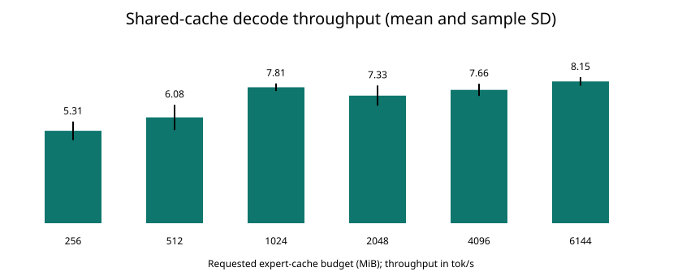

# M5 32 GB: Shared MoE Cache 内存预算与 Decode 性能评估

日期: 2026-11-12。

## 1. 结论

本次测试的是 `codex/moe-out-of-core-p0` 上的 shared-cache 工作区版本: 专家不建立完整的 source Metal buffer，缺失时 `pread` 直接写入有界 shared 专家缓存。不是此前 `codex/moe-iphone-performance` 中已合入每层一次 residency、strict MM 和后台 worker 的版本。

- 256 MiB 到 6 GiB 专家缓存，实测 decode 从 5.31 提升到 8.15 tok/s，平均提升约 53.5%。
- 1 GiB 为 7.81 tok/s，6 GiB 为 8.15 tok/s。多花 5 GiB，均值仅提升约 4.3%; 当前实现中，继续加缓存的收益已很有限。
- 命中率从 3.39% 提高到 84.73%，同步文件加载从每 token 309.15 个专家 bundle 降至 48.87 个，但速度没有相应成倍提升。原因包括系统文件缓存、剩余缺失的单位读取代价，以及 P0 图拆分和等待开销。
- 同机完整模型映射参考为 31.54 +/- 0.60 tok/s。基于 153 GB/s 内存带宽的简化权重流量模型约为 58.3 tok/s; 这是乐观估算，不是当前 Metal 内核应当达到的承诺。
- 小预算存在额外读取放大。256 MiB 每 token 同步需求缺失读取约 563.52 MiB，但整个 decode 实际调用 `pread` 读取约 951.42 MiB。代码中的 token 结束 cache update 会重新准入并加载已经被淘汰的专家，是明确需要优先处理的问题。

**建议: 当前版本在这台机器上先使用 1 GiB 作为容量/速度折中点。优先消除重复读取和逐算子 GPU 等待，再重新扫描预算，而不是直接把默认缓存扩大到 6 GiB。** 这不是对其他输入、长上下文或 iPhone 的通用最优容量结论。

## 2. 硬件、模型与版本

| 项目 | 配置 |
|---|---|
| 电脑 | MacBook Pro，Mac17,2 |
| SoC | Apple M5，10 核 CPU，10 核 GPU |
| 内存 | 32 GiB 统一内存 |
| SSD | Apple SSD AP1024Z，1 TB 配置 |
| 系统 | macOS 26.6.2 |
| 后端 | Release 构建，Metal |
| 基础提交 | `910fa24c5b5096badc31fa7072daa15ae39ff4b6` |
| 工作区修改 | shared cache、可选 MTP tensor 注册修复、本次可选评估计数器; 本表记录归档前的实验状态 |
| 模型 | `Qwen3.6-35B-A3B-UD-Q4_K_M.gguf`，含可选 MTP 权重，普通推理未启用 MTP |

本机实际模型路径:

```text
/Users/litao/Documents/工具/Qwen3.6-35B-A3B-MTP-GGUF/Qwen3.6-35B-A3B-UD-Q4_K_M.gguf
```

M5 的公开统一内存带宽为 153 GB/s，采用十进制 GB/s。见 [Apple M5 MacBook Pro 技术规格](https://support.apple.com/en-ie/125405)。SSD 容量不能直接推出本负载下的有效带宽，本文使用实测专家大小随机读取进行校准，不使用顺序读峰值代替同步 miss cost。

从实际 GGUF tensor 信息读取的体积如下，排除未启用的 MTP 层:

| 项目 | 数值 |
|---|---:|
| 主干层数 | 40 |
| 每层专家数 / 激活数 | 256 / 8 |
| 每 token 专家需求 | 40 x 8 = 320 个 bundle |
| 全部主干专家权重 | 18.225 GiB |
| 平均专家 bundle 大小 | 1.822 MiB |
| 每 token 激活专家权重体积 | 583.19 MiB |
| 其他每步扫描权重的近似体积 | 1.876 GiB |
| 合计活跃权重体积估计 | 2,626,185,728 bytes，约 2.446 GiB |

这里一个 bundle 指同一个 `(layer, expert)` 的 gate/up/down 三份权重，而不是一个 tensor，也不是跨层共享的专家 ID。不同层量化类型和大小可能不同，实际计算使用读取字节数，不强制所有 bundle 等大。

“其他每步扫描权重”按实际存储字节累加非路由专家 tensor，排除只需查表的 token embedding。该模型尚未精确模拟所有内核的重复访存、SLC 命中、KV、activation 和反量化行为。

## 3. 测试方法与统计口径

### 3.1 固定负载

```text
prompt: Explain why the sky is blue in one sentence.
prompt tokens: 11
生成: 128 tokens，ignore EOS，temp 0，seed 42
context: 2048
batch / ubatch: 64 / 64
CPU threads / batch threads: 4 / 4
warmup: 关闭
fit: off，避免自动调整配置
专家缓存: 256 / 512 / 1024 / 2048 / 4096 / 6144 MiB
每档: 3 次，固定种子打乱六档预算的执行顺序，串行运行
```

生成 128 token 对应 llama.cpp 记录的 127 次 decode eval; 第一个输出 token 来自 prompt eval。新增计数器只在单 token residency 开始后统计，本次短 prompt 只有一个 prefill batch，不与单 token decode 混淆。

每次恰好记录 127 个 decode step、5,080 次首次分层路由检查和 40,640 个专家需求。18 次预算运行全部成功，生成文本 SHA-256 一致。另做 3 次完整模型映射参考，输出也一致。

速度为三次 tok/s 的算术均值，误差为样本标准差，不是置信区间。时间分解对每次的 ms/token 求均值，因此不一定恰好等于 `1000 / 平均 tok/s`。

### 3.2 本次新增观测

设置 `GGML_METAL_MOE_CACHE_EVAL=1` 才启用，默认关闭。实现位于 [ggml-metal-moe-cache.mm](../../ggml/src/ggml-metal/ggml-metal-moe-cache.mm)。

- **加载前命中率**: 每层每 token 第一次 gate/up/down residency 检查，在加载前统计所需 bundle 是否已在缓存。不能使用“加载完成后的重复检查命中率”，否则 gate/up/down 后两次检查会虚增结果。
- **同步加载个数**: decode 中 `require` 成功物理加载的 bundle 数。全部运行满足 `同步加载数 = 需求数 - 加载前命中数`。
- **同步需求读取字节**: `require` 路径中的成功文件读取量。
- **decode 总读取字节/时间**: decode 期间全部 `pread` 的实际返回字节/墙钟时间，包含同步需求和 token 结束 cache update、预测加载等，不能只看同步缺失字节。
- **进程磁盘读取量**: macOS `proc_pid_rusage(RUSAGE_INFO_V2).ri_diskio_bytesread` 在 decode 窗口的增量。它是系统归属给进程的存储读取，不是每个专家的 SSD miss 标签。
- **峰值 RSS / footprint**: `/usr/bin/time -l` 的整个进程生命周期峰值，包含模型加载和 prefill; 表中为三次峰值的均值，另列三次中的最大 footprint。

macOS 上缓存命中的 `pread` 仍需要系统调用和数据复制，不等于零成本。系统文件缓存与应用专家缓存是两层不同的缓存，见 [Apple 文件系统性能指南](https://developer.apple.com/library/archive/documentation/FileManagement/Conceptual/FileSystemProgrammingGuide/PerformanceTips/PerformanceTips.html)。

**内存预算只约束专家缓存 buffer，不是整个进程或整机内存上限，也不约束系统文件缓存。** 没有全局 purge 或清空系统缓存，本报告描述的是本机实际系统缓存状态下的反复运行，不是严格冷 SSD 或内存被限额至对应预算的实验。

## 4. 预算扫描结果

全部预算都实际分配到请求容量，没有触发自动缩减。

| 专家缓存 MiB | Decode tok/s，均值 +/- SD | 加载前命中率 | 同步加载 bundle/token | 总文件读取 MiB/token | 峰值 footprint MiB，均值 |
|---:|---:|---:|---:|---:|---:|
| 256 | 5.31 +/- 0.53 | 3.39% | 309.15 | 951.42 | 530.8 |
| 512 | 6.08 +/- 0.73 | 23.63% | 244.37 | 653.02 | 786.4 |
| 1024 | 7.81 +/- 0.22 | 41.39% | 187.54 | 393.33 | 1297.9 |
| 2048 | 7.33 +/- 0.58 | 56.40% | 139.52 | 255.12 | 2322.5 |
| 4096 | 7.66 +/- 0.35 | 75.80% | 77.43 | 141.34 | 4369.1 |
| 6144 | 8.15 +/- 0.25 | 84.73% | 48.87 | 89.37 | 6415.5 |



| 专家缓存 MiB | 三次 decode tok/s | 峰值 RSS MiB，均值 | 最大 footprint MiB |
|---:|---|---:|---:|
| 256 | 5.55 / 5.68 / 4.70 | 3010.0 | 530.9 |
| 512 | 6.48 / 6.52 / 5.24 | 3243.9 | 786.4 |
| 1024 | 8.04 / 7.61 / 7.79 | 3778.1 | 1297.9 |
| 2048 | 7.58 / 6.67 / 7.75 | 4802.2 | 2322.5 |
| 4096 | 7.37 / 8.05 / 7.57 | 6737.1 | 4371.0 |
| 6144 | 8.16 / 7.90 / 8.39 | 8748.6 | 6421.2 |

三次顺序在此按 repetition 编号展示，不是实际执行顺序; 实际随机顺序保存在 records.json。预算越大，确定性的专家命中率越高，但速度在 1 GiB 后不再单调。3 次短运行不足以对 1/2/4 GiB 做严格显著性排序。

RSS 和 footprint 不同，文件映射驻留页也会占用整机资源。不能根据 footprint 只有约 1.3 GiB，就推断整机运行只需要 1.3 GiB RAM，更不能据此推断同等容量 iPhone 的可行性。

## 5. 平均从 SSD 同步加载多少专家?

目前能精确回答的是“平均同步执行文件加载多少 bundle”，即上表的 309.15 到 48.87 个。**不能把这些个数直接称为真正从 NAND/SSD 读取的专家个数**，因为系统文件缓存可能满足 `pread`。

| 专家缓存 MiB | 同步文件加载 bundle/token | 进程磁盘读取 MiB/token | 磁盘字节等效 bundle/token |
|---:|---:|---:|---:|
| 256 | 309.15 | 73.47 | 40.31 |
| 512 | 244.37 | 79.49 | 43.56 |
| 1024 | 187.54 | 57.82 | 31.68 |
| 2048 | 139.52 | 88.28 | 48.36 |
| 4096 | 77.43 | 99.67 | 54.66 |
| 6144 | 48.87 | 84.19 | 46.18 |

等效数计算为 `进程磁盘读取字节 / 本档同步加载 bundle 的平均字节数`，只用于统一量纲。它包含其他权重 page-in、文件预读和 OS 归属时序等影响，也不保证一个 bundle 完全命中或完全缺失。因此不是测得的 SSD 专家 miss 数，不能直接计算 `1 - 等效数 / 同步加载数` 并称为精确文件缓存命中率。

较大专家缓存减少逻辑读取，但本轮进程磁盘读取量没有单调下降。可能涉及系统文件缓存剩余空间、少见专家的剩余 miss 和运行顺序等; 本实验没有控制这些变量，不能把这种相关性直接当作“加缓存一定增加 SSD I/O”的因果结论。

若要精确归属同步 SSD miss，需要进一步对每次专家范围读取记录延迟，并关联内核文件/存储事件和文件偏移。当前的聚合磁盘字节比“所有 pread 都是 SSD”准确，但还不足以提供逐专家 SSD miss 真值。

## 6. 理论与实际性能差距

### 6.1 乐观的硬件权重流量估算

按本模型活跃权重体积，每 token 读取约 2.626 GB:

```text
T_weight = 2,626,185,728 bytes / 153,000,000,000 bytes/s
         = 17.16 ms/token
V_weight = 58.3 tok/s
```

该简化模型假设权重近似扫描一次、完全利用标称带宽，不计 GPU 内核效率、反量化、KV/activation、CPU 和等待，部分权重也可能被硬件 cache 复用，因此它是流量模型的乐观参照，不是经严格证明的绝对速度上限。

shared-cache 的文件读取还需要把数据写入目标专家槽。即使全部由内存中的文件缓存满足，也至少增加近似一读一写的复制流量。用本轮实际总文件读取量计算:

```text
T_DRAM_model = (W_active + 2 * logical_read_bytes_per_token) / 153 GB/s
```

| 专家缓存 MiB | DRAM 流量模型 ms/token | 对应乐观 tok/s | 实测 tok/s |
|---:|---:|---:|---:|
| 256 | 30.21 | 33.11 | 5.31 |
| 512 | 26.12 | 38.29 | 6.08 |
| 1024 | 22.56 | 44.33 | 7.81 |
| 2048 | 20.66 | 48.40 | 7.33 |
| 4096 | 19.10 | 52.35 | 7.66 |
| 6144 | 18.39 | 54.38 | 8.15 |

这些数字显著高于实测，说明不能只用统一内存标称带宽预测当前 out-of-core P0 的 decode。

### 6.2 同机完整模型映射参考

相同模型、prompt 和生成参数，设置 `--moe-cache-size 0`，不走本次 strict 文件专家 residency 图拆分路径:

```text
30.92 / 31.60 / 32.11 tok/s
mean = 31.54 tok/s，sample SD = 0.60 tok/s
mean eval time = 31.71 ms/token
```

此参考比乐观权重流量估算慢约 1.85 倍，表明即使没有有界专家缓存缺失，现有内核/执行也不能直接达到 58.3 tok/s。它比 shared P0 的 6 GiB 档快约 3.87 倍。

完整映射并不等于专家已经全部锁定在物理内存。最后一次参考 RSS 峰值约 21.23 GiB，而 footprint 约 278.5 MiB。它提供同机较宽松内存条件下的现实吞吐参照，但不是低内存方案，也不能把低 footprint 当作没有文件驻留成本。

### 6.3 用真实读取代价校准

另外对模型的随机专家 bundle 做 256 次读取采样，两个文件描述符模式各 128 次，每次 gate/up/down 三段读取，合计约 0.49 GB。一个模式普通 buffered，另一个请求 `F_NOCACHE` 并关闭文件预读; 不写模型、不全局清缓存。

完整模型参考运行后系统已有很多热页。`F_NOCACHE` 请求并没有让全部样本变成冷读取，因此按每个样本的进程磁盘字节增量做诊断分类:

| 分类 | 样本数 | 字节/总耗时得到的有效吞吐 |
|---|---:|---:|
| 归属磁盘字节 >= 请求字节 90% 的 storage-dominated 样本 | 14 | 约 2.33 GB/s |
| 归属磁盘字节为 0 的样本 | 242 | 约 16.08 GB/s |

storage-dominated 样本平均约 0.88 ms/bundle，zero-disk 样本约 0.12 ms/bundle。这是本读取方式的应用层代价，包含三段读取和 Python `os.pread` 分配等开销，既不是 SSD 控制器峰值，也不是 C++ 直接读 shared buffer 的完全等价微基准。尤其只有 14 个磁盘主导样本，分类还有归属时序误差，不能当作严格冷盘测量。

用本轮观测的逻辑字节和磁盘字节近似拆成两层:

```text
R = decode 总逻辑文件读取 bytes/token
D = min(R, 进程磁盘读取 bytes/token)
T_IO_est = D / 2.33 GB/s + (R - D) / 16.08 GB/s
T_reference_plus_IO = 31.71 ms + T_IO_est
```

| 专家缓存 MiB | 校准估算 I/O ms/token | 实测 pread ms/token | reference + I/O 估算 tok/s | 实测 tok/s |
|---:|---:|---:|---:|---:|
| 256 | 90.38 | 100.07 | 8.19 | 5.31 |
| 512 | 73.24 | 80.75 | 9.53 | 6.08 |
| 1024 | 47.95 | 51.11 | 12.55 | 7.81 |
| 2048 | 50.68 | 53.58 | 12.14 | 7.33 |
| 4096 | 47.64 | 50.25 | 12.60 | 7.66 |
| 6144 | 38.29 | 39.84 | 14.29 | 8.15 |

这个模型用了实测磁盘流量，是诊断性校准，不是脱离实测的纯硬件预测。它能近似解释 pread 时间为何不随同步缺失个数等比例下降，但仍不能解释全部推理时间。`reference + I/O` 假设保留完整映射路径的计算效率而不增加 P0 控制成本，因此 14.29 tok/s 不是已实现性能或保证能达到的优化目标。

### 6.4 时间分解与尚未归属的开销

| 专家缓存 MiB | 总 decode ms/token | pread ms/token | 非 pread 剩余 ms/token | 相对完整映射额外非 pread ms/token |
|---:|---:|---:|---:|---:|
| 256 | 189.72 | 100.07 | 89.66 | 57.95 |
| 512 | 166.16 | 80.75 | 85.42 | 53.70 |
| 1024 | 128.05 | 51.11 | 76.95 | 45.24 |
| 2048 | 136.91 | 53.58 | 83.33 | 51.62 |
| 4096 | 130.70 | 50.25 | 80.46 | 48.74 |
| 6144 | 122.80 | 39.84 | 82.96 | 51.25 |

当前 strict 路径在 [ggml-metal-context.m](../../ggml/src/ggml-metal/ggml-metal-context.m) 中对文件专家 `MUL_MAT_ID` 节点拆分图，前一段计算提交并 `waitUntilCompleted`，CPU require 后又单独提交专家节点并等待。gate/up/down 均经过这套路径，40 层有 120 个专家矩阵节点，不能因为 residency 后两次已命中就认为没有提交/等待成本。

新增 require 计时中，扣除 pread 的 CPU 侧工作仅约 0.6-1.1 ms/token。它并不包含外层 GPU 等待。因此不支持把 45-58 ms 全归因于缓存查表，也不支持将它全部精确归因于某一种 GPU 等待。剩余部分还包含图编码、融合/内核路径差异、cache update、路由和同步等。需要 GPU timeline 与逐项消融才能进一步拆清。

## 7. 发现的问题: 小预算的重复加载

| 专家缓存 MiB | 同步需求读取 MiB/token | decode 总读取 MiB/token | 额外读取 MiB/token | 总读取 / 同步需求读取 |
|---:|---:|---:|---:|---:|
| 256 | 563.52 | 951.42 | 387.90 | 1.69x |
| 512 | 445.95 | 653.02 | 207.07 | 1.46x |
| 1024 | 342.31 | 393.33 | 51.02 | 1.15x |
| 2048 | 254.68 | 255.12 | 0.44 | 1.00x |
| 4096 | 141.17 | 141.34 | 0.17 | 1.00x |
| 6144 | 89.11 | 89.37 | 0.26 | 1.00x |

代码过程:

```text
某层 require 加载专家，并完成 GPU 计算
-> 后续层 require 因容量不足淘汰前层专家
-> token 结束 cache_update 扫描本 token 的 access 标记
-> 对已淘汰专家调用 slots.access
-> 如果重新准入，再次 copy_expert / pread
```

`ggml_metal_moe_cache_update` 中的 `slots.access(...)` 和 `if (result.admitted) copy_expert(...)` 保留了原本非 strict 更新路径的装载语义。256 MiB 档预取尝试为 0，仍然出现约 388 MiB/token 的额外读取，因此不能把这个问题都归咎于 Markov 预测错误。

这部分额外读取在小预算下非常显著。报告仅诊断，未在本轮悄悄修改缓存策略，避免将容量对照与策略变更混在一起。下一步可将 strict 需求加载后的统计更新与物理准入分离，对 token 内已经使用且已淘汰的专家只更新热度，不默认重新读取; 如确需保留，则应由独立收益准入判断。

## 8. 优化优先级和成本分配建议

1. **消除 token 结束重复准入/读取。** 首先验证 256/512 MiB 的放大是否消失、输出是否一致、加载前命中率是否因策略变化而改变。最直接的目标是减少真实字节和 pread 时间，而不是美化命中率。
2. **迁入并重新验证每层一次 residency 和全命中快速路径。** 不能简单删掉 GPU 等待: shared buffer 槽位重写必须发生在旧 GPU 读取结束后。应以层为单位保护所需 bundle，并维持正确依赖，再测图边界、提交数和等待时间。
3. **在 strict residency 下保留高效专家矩阵内核。** 重新对比 strict `mul_mm_id`、batch/ubatch 和融合策略。不能把其他分支曾经实现过当作本分支已经具备，也不能用历史速度替代此次消融。
4. **使用真实 miss cost 做缓存分配，但目标改为每字节节省的时间。** 建议评分为 `未来复用概率 x 可避免的同步 miss 时间 / 专家字节数`，结合 prefill 先验和 decode 在线统计。实际 pread 时间比 SSD 顺序峰值更贴近当前损失; 同时要区分系统热页和存储读取，做平滑与采样，避免把偶然慢读直接固化成长期预算。
5. **最后再做异步预取。** 单独测预取准确性、额外字节、淘汰污染、前台等待和峰值 footprint，不只测 hit%。当前 shared buffer 不能允许后台线程覆盖 GPU 正在读取的槽，需要保留/发布协议。
6. **优化后再扫 1/2/4/6 GiB。** 当前约 80 ms/token 的非 pread 剩余使加缓存很快遇到收益平台。消除这个瓶颈之后，缓存容量和成本感知策略的收益曲线会改变。

Prefill 热度是否能预测 decode，需要另做多 prompt、逐层的排序相关性和 held-out decode miss-time 节省测试。本轮只用一个短 prompt，不足以证明 prefill 热度有普遍预测能力; 本轮结果也不是 prefill predictor 的准确率。

## 9. 复现与产物

构建、单测和预算矩阵:

```bash
cmake -S . -B build -DCMAKE_BUILD_TYPE=Release -DGGML_METAL=ON \
  -DLLAMA_BUILD_TESTS=ON -DLLAMA_BUILD_SERVER=OFF \
  -DLLAMA_OPENSSL=OFF -DGGML_CCACHE=OFF
cmake --build build --target llama-completion test-moe-cache test-moe-profile -j 8
build/bin/test-moe-cache
build/bin/test-moe-profile

python3 scripts/moe-cache-budget-eval.py \
  '/Users/litao/Documents/工具/Qwen3.6-35B-A3B-MTP-GGUF/Qwen3.6-35B-A3B-UD-Q4_K_M.gguf' \
  --output moe-cache-eval/budget-new-run \
  --budgets 256 512 1024 2048 4096 6144 --repetitions 3 --tokens 128
```

脚本串行运行、保存每次结果、验证输出一致性，并生成原始 Markdown、summary JSON 和 SVG。断点继续需使用相同参数/版本/模型; 新版本请使用新目录，避免混合数据。脚本当前仅用于此 GGUF 类型及本机 macOS 评估，并非完整通用 GGUF 解析器。

完整模型参考需额外运行，以下命令与本次参考参数一致; 它会占用较多文件驻留内存:

```bash
for repetition in 1 2 3; do
  /usr/bin/time -l build/bin/llama-completion \
    -m '/Users/litao/Documents/工具/Qwen3.6-35B-A3B-MTP-GGUF/Qwen3.6-35B-A3B-UD-Q4_K_M.gguf' \
    --moe-cache-size 0 -c 2048 -b 64 -ub 64 -t 4 -tb 4 \
    -p 'Explain why the sky is blue in one sentence.' -n 128 \
    --ignore-eos --seed 42 --temp 0 --no-display-prompt --no-conversation \
    --no-warmup -fit off -v --log-colors off \
    --log-file "moe-cache-eval/budget-new-run/resident-r${repetition}.log" \
    > "moe-cache-eval/budget-new-run/resident-r${repetition}-output.txt" \
    2> "moe-cache-eval/budget-new-run/resident-r${repetition}-time.txt"
done

python3 scripts/moe-cache-budget-eval.py \
  '/Users/litao/Documents/工具/Qwen3.6-35B-A3B-MTP-GGUF/Qwen3.6-35B-A3B-UD-Q4_K_M.gguf' \
  --output moe-cache-eval/budget-new-run --analyze-only
```

单独重做 I/O 校准可使用同一脚本的 `--calibrate-only`，之后执行 `--analyze-only` 更新派生数据。它不能清除已经存在的系统热页。

本次数据:

- [预算运行脚本](../../scripts/moe-cache-budget-eval.py)
- [逐次原始记录](../../moe-cache-eval/budget-20261112/records.json)
- [模型、硬件、配置指纹及 I/O 校准](../../moe-cache-eval/budget-20261112/manifest.json)
- [汇总与理论模型派生数据](../../moe-cache-eval/budget-20261112/summary.json)
- [机器生成的简表](../../moe-cache-eval/budget-20261112/report.md)
- [图表](../../moe-cache-eval/budget-20261112/decode-budget.svg)
- [Shared cache 改造与前次 private/shared 对照](moe-out-of-core-shared-cache-zh.md)

原始目录保留每次生成文本、完整日志和 `/usr/bin/time -l` 输出。manifest 保存运行时提交、tracked diff SHA-256 和可执行文件 SHA-256; 本文和报告生成脚本等后续文档变更不属于运行时 diff 指纹。动态库没有单独逐个记录哈希，未来复现宜保存完整构建产物。

## 10. 验证边界

- 本次是 1 个 11-token prompt、128-token 输出的 6 档预算评估，不是历史 10 个 2K-8K prompt 的完整评估，不能直接推广到长 prefill 或长输出稳态。
- 未限制整个进程或系统文件缓存; 无法据此宣称在只有 256 MiB/1 GiB 总 RAM 的设备上可运行。
- 未控制温度、后台负载和 OS 文件缓存的全部状态; 采用随机交错顺序和三次重复减少部分顺序偏差。
- footprint/RSS 是进程全生命周期峰值，不是逐 token 内存曲线。未测 iPhone memory warning 或 jetsam。
- 磁盘字节不是逐专家 SSD miss 事件; 冷盘 I/O 校准样本较少，理论估算为解释性模型。
- 正确性检查为固定采样配置下生成输出一致，不等价于覆盖全部模型、量化格式和上下文的数值测试。

本轮完成构建、`test-moe-cache`、Metal `test-moe-profile`、18 次真实模型预算运行和 3 次完整映射参考，全部通过。另核对了输出一致性、需求/命中/加载数量关系、脚本语法、SVG XML 和 `git diff --check`。集成测试中的一次 `failed to read expert 3` 为预期短读故障注入，测试退出码为 0。结果基于归档前的工作区，提交状态以个人仓库 Git 历史为准。
