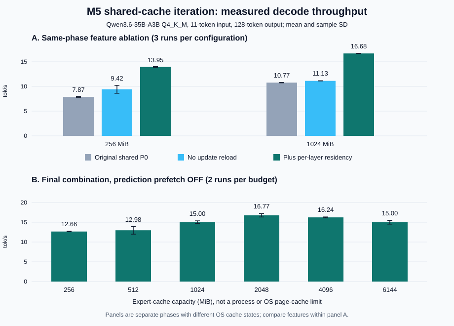

# Shared MoE Cache: 当前分支迭代计划与逐项收益评估

日期: 2026-11-12。平台: MacBook Pro，Apple M5，32 GiB RAM，1 TB SSD。

## 1. 最终结论

基于 `codex/moe-out-of-core-p0` 的 shared-cache 工作区，本轮完成了小步代码移植、功能消融、预算扫描和正确性回归，不是只按历史分支的百分比作预测。

**优先级应当是: 修复无效加载 -> 每层一次驻留 -> strict MM -> 优化真实读取代价 -> 最后再调缓存预测。**

本轮最明确的结果:

| 方案 | 本轮实测 | 判断 |
|---|---|---|
| strict cache update 不重复准入已淘汰专家 | 256 MiB 总读取 951.42 -> 527.52 MiB/token，速度 7.87 -> 9.42 tok/s | 已实现，默认开启 |
| 每层一次 residency | 1 GiB 速度 11.13 -> 16.68 tok/s，+49.85%; 等待 201 -> 41 次/token | 已移植，默认开启，最确定的 decode 收益 |
| strict `mul_mm_id` | 145-token prefill 五轮均值 52.88 -> 62.34 tok/s，+17.89%，但运行波动明显 | 已移植，默认开启; 主要改善 prefill，不能承诺固定收益幅度 |
| Bundle 联合管理与层级执行 | 1,095-token 用例中，启用组合为 13.29，关闭 bundle 为 10.40 tok/s | 应保留; 此对照不是纯替换算法隔离 |
| 强制按 Prefill 热度重建缓存 | 命中率 42.30% -> 43.68%，读取 -2.37%，速度未显示稳定净收益 | 已实现实验开关，默认关闭 |
| 动态层预算、SLRU、Markov、自适应预取 | 各有统计变化，但没有证实独立、稳定的速度优势 | 保留消融能力，不把预测功能当成默认加速保证 |
| 最终预算扫描 | 256 MiB / 1 GiB / 2 GiB / 6 GiB 分别 12.66 / 15.00 / 16.77 / 15.00 tok/s | 本轮 2 GiB 吞吐最好，1 GiB 更省内存; 不是越大越快 |

1 GiB 短输入下，“去重更新 + 每层驻留”的同轮组合收益为 **10.77 -> 16.68 tok/s，+54.91%**。256 MiB 为 **7.87 -> 13.95 tok/s，+77.26%**。这些是同一二进制、同一输入、同一预算下的对照，不能再与历史 Shared/Private 的 +12% 等数字简单相加。

本轮共完成 **64 次缓存配置/功能/回归运行 + 6 次完整模型映射参考 = 70 次真实 Qwen 推理**，不含先行 smoke。构建、策略单测、strict 文件专家数值测试和 52 项 Metal/CPU 运算对照通过。

完整模型映射短输入参考为 **34.50 +/- 0.34 tok/s**，仍明显快于有界文件专家缓存。Out-of-Core 的首要价值是控制专家的应用计算驻留空间，不是保证在 RAM 足够时比完整映射更快。

## 2. 当前分支是什么，哪些已有，哪些新做

基础提交是 `910fa24c5b5096badc31fa7072daa15ae39ff4b6`。实验期间没有切分支或整体合并历史分支; 相关代码和报告随后按用户要求统一归档。无关工作区文件和历史 stash 不包含在本次提交中。

### 2.1 已存在的基础

- 专家 Placeholder、文件 FD/Offset、按需 `pread`、有界 cache slot 和每 tensor page table。
- gate/up/down bundle、SLRU、双时间窗口频率、分层软预算、Prefill profile、Markov seed 和自适应预取控制器。
- 安全容量计算、同步后 resize、释放和重建缓存的 API。
- iOS 示例中的 256 MiB 初始缓存、Q8 KV、memory-warning 缩容和进入后台释放接口。
- 前一轮已完成的 shared cache: `GGUF -> pread 直接写 shared slot -> GPU`，没有 private expert buffer、双 staging 或专家 cache blit。

所以，本轮没有再次“实现 SLRU/Bundle/Out-of-Core”，而是对其现状作组合验证。

### 2.2 本轮新增/移植

| 文件 | 重要修改 |
|---|---|
| [ggml-moe-cache.h](../../ggml/src/ggml-moe-cache.h)、[ggml-moe-cache.cpp](../../ggml/src/ggml-moe-cache.cpp) | `access(..., admit_missing)` 将热度/recency 更新与物理准入分离; reset 可保留实验选择的 protected 区比例 |
| [ggml-metal-moe-cache.mm](../../ggml/src/ggml-metal/ggml-metal-moe-cache.mm) | strict update 去重、same-bundle 查询、MM 开关、Prefill preload/rebuild 开关、加载前 hit 和 I/O 计数、GPU 等待统计、Prefill top-K 覆盖率 |
| [ggml-metal-context.m](../../ggml/src/ggml-metal/ggml-metal-context.m) | 合并同 bundle 且同 router IDs tensor 的专家节点，避免每个矩阵分别提交/等待; 保留逐节点回退开关 |
| [ggml-metal-ops.cpp](../../ggml/src/ggml-metal/ggml-metal-ops.cpp)、[ggml-metal-impl.h](../../ggml/src/ggml-metal/ggml-metal-impl.h)、[ggml-metal.metal](../../ggml/src/ggml-metal/ggml-metal.metal) | strict MM 参数、page table/access buffer 绑定和按缓存偏移寻址 |
| [test-moe-cache.cpp](../../tests/test-moe-cache.cpp) | 验证 observation-only 更新不重新准入、不淘汰，且保留频率统计 |
| [test-moe-profile.cpp](../../tests/test-moe-profile.cpp) | 文件数据、短读、resize，以及 F32/Q4_K/Q5_K/Q6_K 的 strict MV/MM 与 CPU 数值参照 |
| [迭代评估脚本](../../scripts/moe-cache-iteration-eval.py) | 同二进制随机交错消融、输出指纹、I/O/等待/内存/首输出时间、配置及动态库指纹 |

移植参考是历史性能提交 `341d33f40`，没有把依赖 private blit 的后台 worker 整体搬入 shared 路径。

## 3. 迭代开发计划与验收门槛

状态含义: “完成”表示本轮已有代码和数据; “保留/实验”表示机制存在但未证明净收益; “后续”不是已完成的功能或承诺的速度。

| 顺序 | 优先级 | 内容 | 当前状态 | 主要验收条件 |
|---|---|---|---|---|
| R0 | P0 | 固定观测口径、版本/动态库指纹、I/O 与等待分解 | 完成 | 不把 residency 后的重复检查当成加载前命中; 计数与 decode step 一致 |
| R1 | P0 | 去掉 token 结束的重复物理准入 | 完成 | 小预算读取放大明显降低，热度继续更新，输出不因该优化改变 |
| R2 | P0 | 每层一次 residency，同 bundle/同 IDs 才合并 | 完成 | require 120 -> 40 次/token，实际提交/等待减少，读取量基本不变，无旧槽被 GPU 读取时重写 |
| R3 | P0 | strict MM，恢复 ubatch=64 下矩阵矩阵内核 | 完成 | CPU 数值回归通过，与完整映射 MM 输出对齐，prefill 改善 |
| R4 | P1 | Shared/Private 数据路径取舍与预算重扫 | Shared 已有，本轮重扫完成 | 比较 pread 字节/时间、GPU 时间、footprint，不复用 Direct Blit 的历史收益百分比 |
| R5 | P1 | Prefill 初始驻留、rebuild 与在线替换消融 | 评估完成，rebuild 为实验选项 | 包含 TTFT/额外预装读取，不只看 decode hit; 不永久锁定 Prefill 热点 |
| R6 | P1 | 请求阶段/预取反馈计数修正、按真实同步 miss cost 做成本建模 | 后续 | 先分清 prefill/decode、首次实际使用及请求边界，再以每字节节省时间评价; 不把字节数等同于 SSD 时延 |
| R7 | P2 | 在线分层预算、替换参数和并行需求读取 | 后续 | 多输入重复测试; 控制额外 CPU、文件读取和缓存污染，证明端到端收益 |
| R8 | P2/实验 | 自适应预测预取、shared 槽位后台读取 | 现有同步预取已评估; shared 后台 worker 未移植 | 提升前台可见延迟，预取不得覆盖 in-flight 槽; 无稳定收益则不默认开启 |
| R9 | 部署前必需 | iPhone 编译/真机、内存警告、前后台恢复、jetsam | 未在本轮验证 | 不将 macOS RSS/footprint 当作 iPhone 上限; 缩到 0 后必须有明确暂停/恢复协议 |

先落地 R1-R3 再评估 R5-R8 的理由已由实测支持: 约 30 ms/token 的执行边界成本，比本轮多数策略调整产生的差异大得多。

## 4. 测试设计与可比性

### 4.1 公共配置

- 模型: `/Users/litao/Documents/工具/Qwen3.6-35B-A3B-MTP-GGUF/Qwen3.6-35B-A3B-UD-Q4_K_M.gguf`。使用主干 40 层，不启用可选 MTP。
- 每层 256 专家、top-8，每 token 320 个逻辑 bundle 需求。
- context=4096，batch/ubatch=64/64，CPU threads/batch threads=4/4，sequence=1。
- temp=0、seed=42、ignore EOS、禁用 warmup 和自动 fit。
- prefill 实际使用多 token batch; decode 的专家算子每步仍是单 token，并非把 decode batch 设为 64。
- 每个 phase 随机交错执行配置，串行测量，测试期间不并发跑其他 GPU 测试。core 每项 3 次，prefill 每项初测 2 次、追加 3 次，其余主要性能项每项 2 次; 额外三类输入回归每项 1 次。

| Phase | 输入/输出 token | 配置数 x 重复 | 用途 |
|---|---|---:|---|
| core | 11 / 128 | 6 x 3 | 256 MiB、1 GiB 下逐项去重/分层执行 |
| prefill | 145 / 64 | 2 x 5 | strict MV/MM，含完整映射参考后的三轮追加 |
| policies | 1,095 / 128 | 9 x 2 | preload、rebuild、层预算、LRU/SLRU、Bundle、预取 |
| budget | 11 / 128 | 6 x 2 | 最终组合的 256 MiB-6 GiB 扫描 |
| validation | 数学 41、代码 29、中文 30 / 64 | 6 x 1 | 原始组合与优化组合回归 |
| reference | 短输入 3 次，其余 3 种输入各 1 次 | 共 6 | 完整模型映射现实参照及 MM 输出核对 |

1,095-token 输入是脚本内固定的重复工程段落，适合受控消融，但不是自然多领域数据集。**本轮不是历史 10 个 2K-8K 输入的完整矩阵。** 多领域回归仅覆盖运行/输出一致性，不用于宣布任务质量提升。

### 4.2 观测口径

- Hit: 每层每 token 第一次 residency，在物理加载之前统计。不是 gate/up/down 加载后重复检查的命中率。
- 同步加载: 实际成功加载的 `(layer, expert)` bundle。除关闭 Bundle 的实验外，不是 tensor 个数。
- Read: decode 内所有 `pread` 成功返回字节，包含更新和预取; 与 require-only 字节分别保存。
- Disk: 进程 `ri_diskio_bytesread` 的窗口增量，不是精确的逐专家 SSD miss 次数。
- Wait: CPU 在 `waitUntilCompleted` 内停留的墙钟时间，**包含 GPU 执行等待，不是纯同步附加成本**。
- GPU: command buffer 的 `GPUEndTime - GPUStartTime` 区间累计，不等于逐 kernel 硬件计数器采样。
- TTFT proxy: 进程启动到 stdout 首个非空白输出字节的时间，包含加载/编译/CLI 开销，不是服务端请求级精确 TTFT。
- RSS/footprint: `/usr/bin/time -l` 的进程全生命周期峰值; 汇总展示这些峰值的均值，不是 decode 时间窗口内的均值。
- 误差条为样本标准差，不是置信区间; 两次运行的小幅差异不作显著性结论。

新增 `decode_phase` 在完成 Prefill profile/preload 后才打开，避免 prefill 的单 token 尾 batch 混进 decode 统计。全部 64 次缓存运行满足加载数与需求/命中数关系，实际 cache capacity 等于请求值，真实模型 read failures 为 0。

## 5. R1: 修复小预算读取放大

原来某层的专家经过 require 加载并完成计算后，可能被后续层淘汰。token 结束时 `ggml_metal_moe_cache_update()` 又对访问过的专家调用 `slots.access()`，重新准入会再触发一次 `copy_expert()`。

当前增加 `access(..., admit_missing=false)`:

```text
更新短/长期频率
-> 若仍驻留，更新 recency/SLRU 状态
-> 若已淘汰，只记录访问，不重新分配/读取
```

仅文件 strict bundle 的更新使用这条路径，非 strict 热副本路径继续允许正常准入。必须需求加载的 `require()` 不受准入阈值限制，避免策略拒绝导致执行不正确。

| 预算 | 项目 | 原始 shared P0 | 去重更新 | 变化 |
|---|---|---:|---:|---:|
| 256 MiB | decode tok/s | 7.87 +/- 0.08 | 9.42 +/- 0.80 | +19.74% |
| 256 MiB | 总读取 MiB/token | 951.42 | 527.52 | -44.55% |
| 256 MiB | 加载前 hit | 3.39% | 9.58% | 减少更新引起的缓存污染 |
| 256 MiB | 同步加载 bundle/token | 309.15 | 289.33 | -6.41% |
| 1 GiB | decode tok/s | 10.77 +/- 0.04 | 11.13 +/- 0.02 | +3.37% |
| 1 GiB | 总读取 MiB/token | 393.30 | 343.25 | -12.73% |
| 1 GiB | 加载前 hit | 41.39% | 41.25% | 略降，但速度提高 |

这不是“命中率修饰”，而是真实字节减少。代价是被淘汰专家不会因为本 token 曾使用就自动回装，若未来确实需要保留，应由独立收益准入决定。1 GiB 命中率略降也说明去掉回装改变了后续缓存状态，不能假设策略轨迹完全不变。

## 6. R2: 每层一次驻留，减少提交和等待

在保留 R1 的前提下，合并同 bundle、且 `src[2]` 为同一个 router IDs tensor 的 gate/up/down 计算片段。IDs tensor 不同就重新建立边界，不仅凭层名跳过 require。

```text
提交前段计算并完成 Router
-> 一次 require 整个本层所需 bundle 集合
-> 在下一次不同 bundle/IDs 前连续编码计算
-> 等待 GPU 完成后，才允许加载下一组专家和复用旧槽
```

| 预算 | 逐矩阵边界 tok/s | 每层边界 tok/s | 提升 | 实际 wait 次/token |
|---|---:|---:|---:|---|
| 256 MiB | 9.42 +/- 0.80 | 13.95 +/- 0.07 | +48.04% | 201 -> 41 |
| 1 GiB | 11.13 +/- 0.02 | 16.68 +/- 0.04 | +49.85% | 201 -> 41 |

require 调用为 120 -> 40 次/token。实际 wait 是 201 -> 41，而不是简单写成 120 -> 40，因为旧代码还单独提交专家节点和非专家片段。报告采用新增计数器的实测值。

1 GiB 的时间分解:

| 配置 | 总 ms/token | pread ms/token | CPU wait ms/token | 其中 GPU 区间 ms/token |
|---|---:|---:|---:|---:|
| 原始 shared P0 | 92.84 | 22.60 | 66.44 | 31.03 |
| 去重更新 | 89.85 | 19.82 | 66.45 | 31.01 |
| 再加每层驻留 | 59.94 | 20.14 | 36.95 | 30.34 |

GPU 区间只减少约 0.67 ms，而 CPU wait 减少约 29.50 ms，证据支持收益主要来自提交/等待边界，而不是命中率、文件读取量或 GPU 算力突然变化。不能再将 GPU 区间与 wait 相加，否则重复记账。

1 GiB 全进程 user/system CPU 时间均值分别为原始 2.21/4.03 秒、去重 2.20/3.68 秒、每层驻留 2.05/3.23 秒。它们是全进程 CPU 累计时间，不是可直接加到 token latency 上的串行分量。

峰值 footprint 约 1,338 MiB，几种配置基本不变。Shared 路径本来没有复制队列等待，整次全命中不做 `pread`; 因此没有把历史 private 路径的“全命中免 copy wait”再单独声称为一项新增百分比收益。

## 7. R3: strict MM

给 `ggml_metal_kargs_mul_mm_id` 增加 strict 标记，并为 kernel 绑定 page table 和 access buffer。strict MM 不再用 `expert_id * original_stride` 访问完整专家权重，而是从页表取 shared cache 内偏移。CPU residency 先保证当前 batch 的 required set 全部可用。

当 token batch 不少于 32、形状及设备条件满足时，允许 strict 路径选择 MM; 单 token decode 仍走 MV。没有新增一套独立的矩阵乘内核。

| 指标 | strict MV | strict MM | 观察 |
|---|---:|---:|---|
| 145-token prompt tok/s +/- SD | 52.88 +/- 9.67 | 62.34 +/- 12.24 | 五轮均值 +17.89%，波动明显 |
| 首输出 proxy 秒 | 3.21 | 2.91 | 均值减少约 0.30 秒 |
| decode tok/s +/- SD | 14.84 +/- 0.45 | 14.94 +/- 0.75 | 不作为独立 decode 提速证据 |
| 峰值 footprint | 约 1.31 GiB | 约 1.31 GiB | 基本不变 |

初测两轮均值为 MV 48.60、MM 67.58 tok/s，即 +39.07%。检查发现首轮 MV 有较冷读取状态，因此在完整映射参考之后再追加每种三次，保留全部结果，不筛掉慢样本。完整五轮 prompt 吞吐为:

```text
MV: 36.11, 61.08, 55.08, 56.35, 55.77 tok/s
MM: 61.79, 73.37, 41.71, 67.63, 67.18 tok/s
```

追加阶段首个 MM 也明显较慢，说明“前面已跑过完整模型”不能等同于严格控制的全热状态。最终只报告五轮均值和波动，不把初测 +39% 当作稳定的纯内核收益; 后续需要显式 I/O 状态控制和 prefill GPU 时间分解。

MV 和 MM 的浮点累加顺序不同，145-token 输入生成文本不同; 41-token 数学回归也出现这种差异。不能声称所有 70 次运行输出全部相同。

正确性依据是:

1. F32/Q4_K/Q5_K/Q6_K，token=1/32/64 的 strict 文件图计算与 CPU 数值参照通过，覆盖相同和不同 IDs、重复计算; CPU 参考使用实际量化后再反量化的权重，NMSE 小于 `5e-4`。
2. 原始权重 buffer 写为 0，文件包含真实测试权重，避免错误回退原 buffer 也能蒙混通过。
3. 52 项普通 Metal/CPU `MUL_MAT_ID` 对照通过，检查新增 ABI 没有破坏非 strict 路径。
4. 真实 Qwen 的 short、145-token prefill、1,095-token long、math 四种输入，strict MM 与完整映射原有 MM 的输出 SHA-256 全部一致; 其中 short 参考重复 3 次。
5. 同一性能配置的重复运行输出一致。全部 9 种 policy 变体输出一致; short 的 core/budget 变体输出一致。

因此不能把跨 MV/MM 的文本不同直接视为 cache 数据错误，也不能把不同输出造成的 decode 路由差异误当成 MM 的单独 decode 收益。

## 8. R4: 数据路径与最终内存预算

### 8.1 Shared 与 Direct Blit 的适用边界

Shared 路径在本轮开始前已经落地。前轮相同加载计数和输出下，private/shared 两次均值为 5.455/6.110 tok/s，约 +12%，平均 footprint 少约 72.9 MiB，详见 [Shared 改造报告](moe-out-of-core-shared-cache-zh.md)。这是历史受控小样本，不是本轮新增收益。

旧 Direct Blit 要求完整专家 source 已是 shared Metal buffer，不能为了复用它又把全部专家注册回常规 Metal。当前不移植该路径，也不把旧分支 +21.36% 当成 P0 可直接再得的收益。

### 8.2 最终组合预算扫描

以下统一开启 R1/R2/strict MM，关闭预测预取，保留现有 SLRU、动态软预算和非 rebuild preload。每档两次; 与 core 是独立交错 phase，不把跨 phase 的系统缓存状态当作相同。

| 专家缓存 MiB | Decode tok/s +/- SD | 加载前 hit | 同步加载 bundle/token | 总读取 MiB/token | 进程磁盘 MiB/token | 峰值 footprint MiB |
|---:|---:|---:|---:|---:|---:|---:|
| 256 | 12.66 +/- 0.07 | 9.58% | 289.35 | 527.45 | 0.04 | 570.6 |
| 512 | 12.98 +/- 0.98 | 23.74% | 244.05 | 445.15 | 9.77 | 826.4 |
| 1024 | 15.00 +/- 0.36 | 41.21% | 188.12 | 343.34 | 2.96 | 1337.9 |
| 2048 | 16.77 +/- 0.43 | 56.41% | 139.50 | 254.64 | 2.88 | 2363.0 |
| 4096 | 16.24 +/- 0.11 | 75.80% | 77.43 | 141.17 | 28.36 | 4410.7 |
| 6144 | 15.00 +/- 0.47 | 84.72% | 48.91 | 89.17 | 48.71 | 6460.6 |



关闭预取后的各档 decode 总读取恰好等于同步需求读取，验证了文件 strict update 的重复读取放大已消除。命中率随预算提高，但 4/6 GiB 没有继续提速。

本轮 2 GiB 相比 1 GiB 速度均值约 +11.7%，多占约 1 GiB footprint。6 GiB 比 1 GiB 多占约 5 GiB，速度均值基本相同。建议以 **1 GiB 作为低 footprint 起点，2 GiB 作为这台 Mac 的候选吞吐配置**，不要设成所有设备/输入通用最优值。

这里约束的只是专家缓存 buffer。32 GiB RAM 大于约 21 GiB GGUF，系统能保留大量模型文件热页。没有限制系统 Page Cache，也没有用其他进程制造全局内存压力。

因此不能说“256 MiB 总 RAM 也能以 12.66 tok/s 跑这个模型”。大缓存还可能挤压系统文件缓存，少量剩余专家缺失可能变贵; 本轮确实观察到较大预算的进程磁盘字节更多，但没有控制全部 OS 状态，不将这种相关性当作严格因果证明。

### 8.3 与硬件理论的差距

主干活跃权重的近似存储体积为 2.626 GB/token。按 [Apple M5 的 153 GB/s 公开带宽](https://support.apple.com/en-ie/125405)，理想一次权重扫描约 17.16 ms/token，即 58.3 tok/s。它忽略反量化、KV、重复访存、硬件 cache、内核效率和调度，仅为乐观流量模型。

本轮完整模型映射短输入参考为 34.11/34.68/34.71 tok/s，均值 34.50; 与专家缓存方案不是同等低内存约束。最后一次 RSS 峰值约 21.23 GiB，footprint 只有约 319 MiB，不能因此宣称完整模型只占 319 MiB。

对 core 的 1 GiB 分层路径，59.94 ms/token 中 pread 20.14 ms，CPU wait 36.95 ms，其中 GPU 区间 30.34 ms。即使理想化地消除全部未隐藏读取、其他成本完全不变，也只有约 `1000 / (59.94 - 20.14) = 25.1 tok/s`，还到不了完整映射的 34.5。

这只是固定其余成本的 Amdahl 估算，不是某个尚未实现的预取功能能保证达到的速度。它说明下一步既要减少 I/O，也要继续减少 residual 同步/图执行成本。

## 9. R5: Prefill、替换策略、Bundle 的逐项消融

以下均为同一 1,095-token 输入、1 GiB 缓存、128 输出 token，每配置两次。

| 配置 | Decode tok/s +/- SD | Hit | 读取 MiB/token | 首输出 proxy 秒 | 新预装条目 |
|---|---:|---:|---:|---:|---:|
| 当前组合，无预测预取 | 13.29 +/- 0.67 | 42.30% | 336.63 | 17.67 | 25 |
| 关闭 preload | 13.45 +/- 0.04 | 42.23% | 337.06 | 17.41 | 0 |
| Prefill 热度重建缓存 | 13.43 +/- 0.04 | 43.68% | 328.64 | 17.67 | 562 |
| 相等层软预算 | 13.27 +/- 0.59 | 41.82% | 339.41 | 17.55 | 25 |
| protected=0 的分层 LRU | 13.93 +/- 0.04 | 42.10% | 337.83 | 16.63 | 15 |
| 关闭 Bundle | 10.40 +/- 0.06 | 34.51%* | 376.49 | 26.53 | 56* |

`*` 关闭 Bundle 后按 tensor 计数，需求分母为 960/token 而非 320/token，hit 和条目数不能直接和 bundle 数字作同量纲优劣判断。

### 9.1 Prefill 是否真的有预测能力?

新增只读评估: 按相同每层字节预算选择 Prefill top-K，观察之后真实 decode 路由落入这些专家的比例。1 GiB 对应每层约 13-14 个专家，不让 decode 结果反向参与选择。

| 范围 | Prefill top-K 对真实 decode 需求的覆盖率 |
|---|---:|
| 全 127 个 decode step | 19.22% |
| 前 32 step | 25.69% |
| 后 95 step | 17.03% |
| 同容量随机选择的期望 | 约 5.44% |

这是需求加权 recall，不是二分类 accuracy，也不是实际缓存 hit。结果说明 Prefill 先验有信息，早期更强，但固定热点集合仍漏掉大多数 decode 需求，不能永久锁定。

现有 preload 只填剩余空间、不主动赶走 Prefill 结束时已驻留的专家。因 strict prefill 本身已经加载专家，本次只额外装入 25 个条目，不是从空 cache 装满。

本轮新增实验开关 `PRELOAD_REBUILD=1`: 在 Prefill 完成且 GPU 已同步后，失效页表、重置 slots，再按热度/字节和层预算重新填充 shared buffer。它装入 562 条、约 1,023.5 MiB，平均比现有 preload 多读约 978.2 MiB 的初始数据。没有分配第二个 1 GiB cache。

重建使 hit +1.38 pp、decode 读取 -2.37%，但未证明稳定净提速，首输出也没有稳定优势，所以默认关闭。首输出差异还包含 prefill/OS 状态变化，不能把其全部差值归给预装本身。

### 9.2 SLRU 和层预算

当前 SLRU 与 `4 * F_short + F_long` 仍保留。protected=0 的实验去掉保护区，但仍保留相同层水位和统计开销，不是完全无分组、无频率维护的全局纯 LRU。

这组数据不能证明 SLRU 比简化 LRU 更快，也不足以将其全局改为 LRU: 当前组合 SD 为 0.67 tok/s，且几种配置的进程磁盘读取约 26-28 MiB/token，并非完全相同。结论是保留兼容实现及开关，不宣称复杂策略天然优于简单策略。

动态层预算相对等分少读约 0.82%，速度约相同。当前预算成本项仍是专家字节，不是实测 SSD 时延。其形式近似 `expected_hits * read_bytes / aligned_size`，当 read_bytes 接近 size 时主要仍是热度，而非硬件成本。

### 9.3 Bundle

关闭 Bundle 同时改变 cache 粒度、profile/Markov 管理次数，以及能否把 gate/up/down 合成一次 residency。实测 wait 为 121 -> 41 次/token，读取为 376.49 -> 336.63 MiB/token，组合吞吐 +27.84%。

所以这个结果支持保留 Bundle 作为当前层级执行的基础，但不能声称“Bundle 替换算法本身单独提速 27.84%”。它与旧热副本分支 Bundle 因搬运增多而回退的结果不矛盾，执行路径不同。

## 10. R8: 自适应预取与 Markov

| 配置 | Decode tok/s +/- SD | 读取 MiB/token | 预取尝试 | useful / wasted |
|---|---:|---:|---:|---|
| 不预测预取 | 13.29 +/- 0.67 | 336.63 | 0 | 0 / 0 |
| Markov + adaptive | 13.38 +/- 0.48 | 336.69 | 42 | 10 / 32 |
| Markov + 固定预算 | 13.44 +/- 0.00 | 342.83 | 508 | 95.5 / 412.5 |
| 关闭 Prefill Markov seed，保留 adaptive | 13.60 +/- 0.06 | 336.63 | 0 | 0 / 0 |

计数是现有 bookkeeping 的两轮均值，0.5 不是半个实际事件。adaptive 相比固定预算，尝试约 -91.7%、记录的 wasted 约 -92.2%、读取约 -1.79%; 记录的 useful/admission 约 23.8% 和 18.8%。它能抑制无效 I/O，但吞吐差异没有证明稳定净收益。

另外发现一项继承问题: `decode_updates` 在现有 `cache_update` 中按 observed-routes 更新推进，strict prefill 的多个 ubatch 也会计入。1,095-token prompt 有 18 个 ubatch，本轮提供的 `REMAINING_TOKENS=128` 因而不是严格的“还剩多少 decode token”，自适应控制可能提前进入停止区。新增的测量用 `eval_steps` 已隔离 decode，两者不要混淆。

因此上述消融衡量的是现有控制器整体行为，不能把所有尝试减少归因于反馈算法本身。后续首先应在请求边界重置控制器、以实际 decode 步数推进 horizon，并明确禁止/限制 prefill 期间的预测装载，再做一次不带剩余长度 hint 的独立对照。

还需修正反馈时机: 当前 `require()` 命中预取项后，useful 到 token 结束扫描 access 时才确认。如果专家已经被 GPU 使用、随后又在该 token 内被后层淘汰，`invalidate()` 可能先将其记为 wasted。因而上述 useful/admission 不能称为严格的预测 precision。下一轮应在成功需求消费处确认首次使用，并避免与 token-end 重复计数，之后再判断 predictor 本身好坏。该问题不改变本轮实际读取量与 token/s 结果，但会影响自适应决策与统计解释。

本轮所有配置的真实模型 `cost rejections` 为 0。完整 victim-set 成本逻辑有单测覆盖，但该生产计数没有触发，不能声称它在本轮贡献了可量化收益。强制需求 `require()` 本来就不能因为收益评分不足而拒绝计算所需专家。

**本轮推荐启动配置显式关闭预测预取。** 为保持已有行为兼容，历史 `PREFETCH` 环境开关的代码默认值未改成 0; 不要把“推荐关闭”误认为“该继承默认已经改变”。Shared 路径的跨层后台 worker 未移植，历史 private worker 的 +2.2% 且不稳定结果不能迁入此表。

## 11. 下一轮尚未实现的方案: 如何评估收益和代价

### 11.1 请求阶段与预取计数修正，优先于新 predictor

修改 `decode_updates` 的阶段/请求边界，区分 Prefill 统计与 Decode 在线观察，并将 useful 确认前移到成功需求消费。验收包含多个 prefill ubatch、最后 1-token 尾 batch、连续两次请求、结束前停止预取，以及“已使用预取项在本 token 内被淘汰”不再误计 wasted。该修正的目标先是控制逻辑正确，不预先承诺提速。

### 11.2 实际 miss cost 感知的分配/准入

建议目标从命中率改为每单位缓存字节能避免的前台时间:

```text
value(layer, expert)
    = P(reuse before eviction) * expected_unhidden_load_time / resident_bytes
```

需要新增的不是一个统一“SSD GB/s”常数，而是带采样与平滑的读取代价模型:

- 测量同步加载的端到端 `pread`/CPU 写 cache 时间，并区分文件热页与疑似存储读取。
- 低频专家冷启动时使用层级先验，避免单次抖动永久决定预算。
- 候选与完整 victim set 使用同量纲的预期时间，保留 required/in-flight 专家保护。
- 在线反馈以实际 saved milliseconds、额外读取和 token latency 评价，而非只看 hit。

本轮 budget phase 已显示按缺失个数推断成本不够: 1 GiB 有约 188 次同步加载但只有约 2.96 MiB/token 进程磁盘字节; 6 GiB 只有约 49 次同步加载，却有约 48.71 MiB/token 磁盘字节。它们不是精确的 SSD 专家数，包含系统归属和其他模型读取，仍需逐范围追踪才能作严格归因。

收益预期: 当部分层/专家的剩余缺失更贵时，比按字节/频率分配更有机会节省时间。代价: 采样开销、时间噪声、OS 缓存状态变化及策略自反馈。本轮未实现该在线模型，未给出虚构的速度提升。

### 11.3 已知 required set 的并行读取

比不准确的预测更直接的下一步，是并行读取当前层已经确定的缺失专家。复用固定小线程池，先保留不重叠槽，再写入各自范围，全部完成才发布页表/提交 GPU。

收益上限受本轮约 20-38 ms/token 的 pread 区间限制，不可能超过消除全部未隐藏读取的理想上限。代价是更多 CPU/功耗、SSD 队列竞争和错误处理复杂度; 不能把更多读取线程必然等同于更快。应分别测 1/2/4 个 worker、文件热/冷状态和前台延迟。

### 11.4 在线分层软预算

将 Prefill 水位作为初始先验，用 decode 的需求率、miss time、逐层收益曲线缓慢调整，保留最小公平份额和变化幅度限制。验收重点是多输入和 256/512-token 稳态，不因一层暂时冷就永久剥夺容量。

### 11.5 Shared cache 后台预取

历史 worker 的 `pread -> staging -> private blit` 不能原封不动用于 shared cache。应先设计 slot reservation、in-flight pin、加载完成发布、按需等待与取消/resize 协议。只允许后台写当前 GPU 不会读取的范围，mutex 不能替代 GPU 生命周期依赖。

在 predictor 没有证明 saved time 大于额外 I/O/淘汰代价之前，不值得先增加这套并发复杂度。

### 11.6 iPhone 部署

P0 已有 iOS 安全容量和示例通知接入，不能再列成完全从零实现。未完成的是本轮改动的 iOS 构建/真机回归、压力响应、取消与前台恢复。

特别是缩到 0 后，专家文件没有完整 source Metal buffer，不能假设随后继续 decode 会自动安全回退。需暂停生成并显式恢复缓存，再验证下一次推理。真实 jetsam、thermal throttling、后台恢复与低内存读成本，均不能由这台 32 GiB Mac 的结果替代。

## 12. 推荐配置与一键复现

当前低 footprint 起点:

```bash
GGML_METAL_MOE_CACHE_STRICT_UPDATE=1 \
GGML_METAL_MOE_CACHE_LAYER_RESIDENCY=1 \
GGML_METAL_MOE_CACHE_MM_ID=1 \
GGML_METAL_MOE_CACHE_PREFETCH=0 \
GGML_METAL_MOE_CACHE_PRELOAD_REBUILD=0 \
build/bin/llama-completion \
  -m '/Users/litao/Documents/工具/Qwen3.6-35B-A3B-MTP-GGUF/Qwen3.6-35B-A3B-UD-Q4_K_M.gguf' \
  --moe-cache-size 1024 -c 4096 -b 64 -ub 64 -t 4 -tb 4 \
  -p 'Explain why the sky is blue in one sentence.' -n 128 \
  --ignore-eos --seed 42 --temp 0 --no-conversation --no-warmup -fit off
```

新加的 `STRICT_UPDATE`、`LAYER_RESIDENCY`、`MM_ID` 默认开启。`PRELOAD` 默认开启但不强制重建，`PRELOAD_REBUILD` 默认关闭，`PROTECTED_PERCENT` 默认 80。开关为本地实验接口，不是稳定公共配置 API。

完整复现本轮 64+6 次真实模型运行、构建和测试:

```bash
bash scripts/moe-cache-iteration-eval.sh \
  '/Users/litao/Documents/工具/Qwen3.6-35B-A3B-MTP-GGUF/Qwen3.6-35B-A3B-UD-Q4_K_M.gguf' \
  moe-cache-eval/iteration-new-run
```

默认 core=3 次、feature=2 次、budget=2 次、validation=1 次，完整映射参考后再追加每种 3 次 prefill 对照。可通过 `CORE_RUNS`、`FEATURE_RUNS`、`BUDGET_RUNS`、`VALIDATION_RUNS`、`PREFILL_EXTRA_RUNS` 调整; `BUILD=0 RUN_TESTS=0` 可复用已构建产物。

脚本产出逐次日志、输出、`/usr/bin/time -l`、records/summary JSON 和机器生成简表。它会清除继承的 MoE 实验环境变量，再显式设置各 case 参数，防止其他终端环境混入实验。主矩阵支持相同指纹断点继续，改变二进制/动态库/脚本后应使用新目录。

原始数据与复用入口:

- [一键脚本](../../scripts/moe-cache-iteration-eval.sh)
- [主消融脚本](../../scripts/moe-cache-iteration-eval.py)
- [完整映射参考脚本](../../scripts/moe-cache-iteration-reference.py)
- [64 次逐次记录](../../moe-cache-eval/iteration-20261112-v1/records.json)
- [汇总结果](../../moe-cache-eval/iteration-20261112-v1/summary.json)
- [模型、输入与运行指纹](../../moe-cache-eval/iteration-20261112-v1/manifest.json)
- [6 次完整映射参考及输出匹配](../../moe-cache-eval/iteration-20261112-v1/reference-records.json)
- [机器生成全表](../../moe-cache-eval/iteration-20261112-v1/report.md)
- [strict 文件专家数值测试日志](../../moe-cache-eval/iteration-20261112-v1/test-moe-profile.log)
- [52 项普通 Metal/CPU 对照日志](../../moe-cache-eval/iteration-20261112-v1/test-backend-ops.log)

## 13. 解释边界和未解决问题

1. 前一份 [预算报告](moe-shared-cache-budget-m5-evaluation-zh.md) 的 shared P0 1 GiB 为 7.81 tok/s，本轮 core 原始 shared 为 10.77 tok/s。OS 文件缓存、上下文和阶段状态不同，不能直接把 7.81 -> 16.68 全算作代码收益; 本文只按同轮 A/B 归因。
2. 热文件 `pread` 不等于零开销。即便 core 的磁盘增量几乎为 0，1 GiB 仍有约 20 ms/token 的逻辑读取/复制成本。M5 的 153 GB/s 是统一内存标称带宽，不是单线程系统调用复制能达到的吞吐。
3. 多数 policy 差异小于/接近两轮运行噪声。不能用一张 hit 表证明复杂策略普遍更好，更不能把本文所有百分比相加。
4. 用途是推理性能和内存行为评估，不是 perplexity、任务质量、长序列、多 sequence 或 MTP 正确性认证。
5. Swift 示例已接入部分内存生命周期处理，但本轮没有构建/运行 iPhone，也没有测 jetsam 或移动设备 SSD/功耗。
6. 仍需补齐实际 decode horizon/请求 reset、在线 miss cost、自然多领域长输入、256/512-token 稳态和 GPU timeline 的细粒度归因。

本文记录提交前工作区的实验结果。归档包含代码、测试、复现脚本、精简评估 JSON/图表及小体积测试日志; 逐次推理大日志、模型和构建产物只保留在本地，未纳入 Git。提交和推送状态以个人仓库 Git 历史为准，没有创建上游 PR 或评论。
